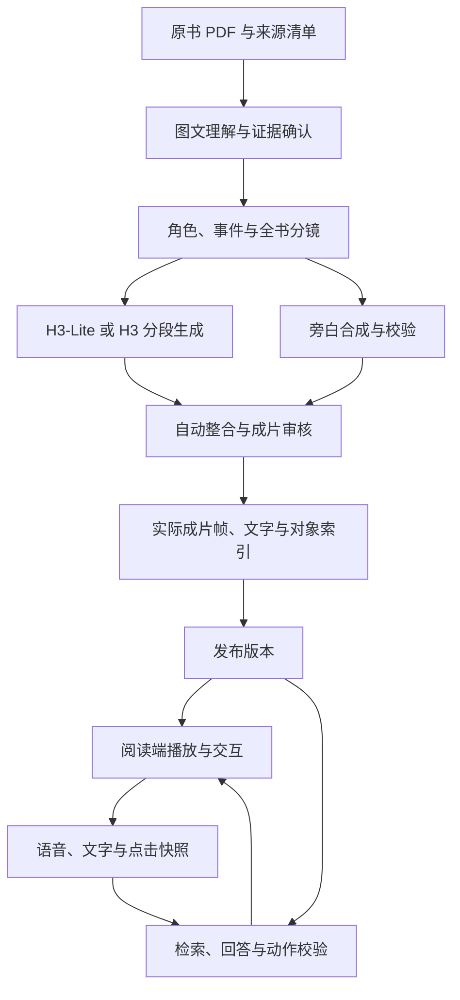

# 页语｜纸书智伴企业线上赛完整工作计划 V2.1

> 版本：2026-11-20 素材核验与引用修订版（V2.1）  
> 用途：从已通过校赛的项目推进到企业线上赛完整作品的内部执行手册。  
> 执行方式：按依赖关系和验收条件推进；不安排人员分工。**外部截止（2026-11-25 18:00）优先于一切内部原则**——倒计时、时间块、最晚决策点与降级开关见 [`5日执行卡.md`](5日执行卡.md)，本文件只保留能力标准与验收口径。  
> 技术主线：DeepSeek V4.1 Flash；开发视频 MiniMax H3-Lite 480P；正式视频 MiniMax H3；语音按三条链路选型；React/TypeScript + FastAPI 继续迭代。  
> 证据状态：文件内容已分析、官方接口已查证、代码结论来自固定提交；模型质量、耗时、成本实账和用户体验仍需实施阶段实测。

### V2.1 修订记录（相对 V2）

1. **引用去私有化。** V2 中有 19 条资料链接指向对话工具私有库并内嵌账号标识，他人无法打开。现已全部替换：绘本与题单直连仓库内文件，官方 8 份原始材料改由 [`清单/素材与资料索引.md`](清单/素材与资料索引.md) 承接。
2. **素材状态更新。** 6 本 PDF（含此前缺失的中文绘本03）、6 份 TXT、**300 个 WAV** 已全部到位，见 `清单/素材清单.csv`、`清单/音频映射.csv`、`清单/题单解析.csv`。
3. **必选音频数量已核对。** 文件名 `(必选)` 标记与题单 `（必选）` 完全一致：77 段必选音频、13 个必选点击，每册 15 个必选动作点。
4. **§3.1 / §3.2 / §3.4 / §11.4 / §23.3 / §26.2 / §30.4** 中"CN03 PDF 待补""WAV 未到位""代理音频替代"等表述已按实际核验结果改写。
5. **§2.2** 补入两条外部硬约束：提交截止 2026-11-25 18:00；500 元 API 额度于 2026-11-30 随晋级名单发放。
6. **§4.7** 正式书定案：中文 CN01 + 英文 EN01（依据从"覆盖度"改为"五天窗口下可交付性"）。
7. **§13.4** 补入音频尾部静音实测（最长 1.385 秒），规定"话音结束"必须用能量阈值测，不得用文件长度。
8. **§2.3 / §19.1 / §19.3 / §29.1** 增加：交付分辨率暂定 1080P、播放端三档（`renditions`）、清晰度入口与 `RenditionMenu`、模型切换配置与 `ModelPicker`。
9. **执行节奏**：外部截止优先；排期见 [`5日执行卡.md`](5日执行卡.md)（生成任务异步挂机，不占用人的时间）。

## 阅读导航

- [01 本版决策与完成目标](#s01)
- [02 官方要求与范围](#s02)
- [03 新上传材料、题单结构与缺项](#s03)
- [04 逐书实施重点与提交书建议](#s04)
- [05 当前代码基线与优先修复](#s05)
- [06 总体架构、数据契约与版本](#s06)
- [07 官方素材理解与内容证据](#s07)
- [08 DeepSeek 接入与回答契约](#s08)
- [09 H3-Lite 到 H3 的生成方案](#s09)
- [10 全书分镜、旁白与成片](#s10)
- [11 ASR 调研与选择](#s11)
- [12 离线旁白与在线 TTS 选择](#s12)
- [13 语音适配、自然度与低延迟](#s13)
- [14 证据问答与跨语言历史](#s14)
- [15 实际成片检索、文字与动态触控](#s15)
- [16 播放、录音、回答与取消状态](#s16)
- [17 UI 研究与产品定位](#s17)
- [18 视觉设计系统](#s18)
- [19 页面、组件与响应式规格](#s19)
- [20 交互状态、微文案与可访问性](#s20)
- [21 工程稳定性、成本与来源管理](#s21)
- [22 每次检查的计划制度](#s22)
- [23 分层检查批次与消耗上限](#s23)
- [24 合格性指标与错误处理](#s24)
- [25 功能验收用例库](#s25)
- [26 验收门与工作清单](#s26)
- [27 四视频与项目说明书](#s27)
- [28 新书复用、创新证据与现场准备](#s28)
- [29 配置、接口与记录模板](#s29)
- [30 最终发布清单与待补项](#s30)
- [参考资料](#sources)

<a id="s01"></a>

## 01 本版决策与完成目标

### 1.1 本轮更新的六项决定

1. **开发视频采用 MiniMax-H3-Lite 480P。** 用于适配器联调、分镜效果初筛、工作流及播放器验证。正式提交和正式生成采用 MiniMax-H3，经正式配置验收后发布。
2. **把语音输入、离线旁白、在线播报分别选型。** Whisper 不再是必须保留的主方案。Breeze TTS 2 MLX 8bit 进入旁白优先候选；自然度、双语、设备适配、许可和延迟一起决定最终选择。
3. **以真实绘本和顺序题单设计功能。** 已取得六本 PDF、六份 TXT 与 300 段 WAV。TXT 是交互题单，包含编号问题与额外点击步骤；音频按编号一一对应。
4. **升级儿童与亲子阅读界面。** 阅读端突出故事，制作台管理导入、生成、费用、审核和导出。继续使用现有 React/TypeScript，不为了换视觉重建产品。
5. **每次检查先写计划。** 写明待验证风险、范围、样本、步骤、通过条件、调用与费用上限、停止条件、失败后的最小复测范围。
6. **用低成本证据复用减少消耗。** 纯样式和状态测试使用固定响应及已有媒体；仅新风险、接口变化和发布门禁触发真实模型检查。两本正式书的官方音频完整验收合并完成多项统计。

### 1.2 最终产品状态

读者可以打开完整中英文绘本视频，在播放中点选目标，暂停后听到相关讲解，继续围绕该对象追问；也可以用中文或英文要求跳到某一场景、框出目标、描述实际画面或定位画面文字。系统保留本册完整阅读上下文，支持打断、暂停、继续和结束。

制作端从授权 PDF 出发，完成图文理解、角色与事件整理、全书分镜、分段视频、配音、自动整合、成片审核和实际成片索引。每个结果都有来源、模型、版本和运行记录。更换绘本时复用同一流程。

### 1.3 三类结果必须分开

- **已核验事实**：附件内容、固定提交中的代码行为、官方文档公布的接口和价格。
- **设计决定与内部目标**：候选模型、UI 色彩与尺寸、检查样本量、质量阈值、预算上限。
- **实施后结果**：真实音频正确率、两秒达标率、生成质量、实际费用和用户观察。

本文件不把第二类写成第三类，也不把作者的模型宣传数据写成本队设备成绩。所有模型调用和安装均属于后续实施工作，本轮完成的是研究、素材分析与计划修订。

<a id="s02"></a>

## 02 官方要求与范围

### 2.1 要求—交付—验收矩阵

| 官方要求 | 项目交付 | 合格性检查 |
|---|---|---|
| 整本 PDF 图文理解 | 逐页文字、图像观察、角色、事件和来源 | 页码可核对，重要无字页有记录 |
| 正文每页有所体现，关键情节完整 | 源页—分镜—成片覆盖矩阵 | 正文与关键事件完整覆盖 |
| 风格与页间连贯 | 角色/场景规范、镜头组织、真实成片审核 | 身份、道具、事件和视觉风格稳定 |
| 非交互视频 100—200 秒，提交控制在 3 分钟以内 | 本计划统一采用 100—180 秒 | 实际媒体时长符合统一 profile |
| 至少 1280×720、至少 24 fps，推荐 1080P | H3 正式输出与统一编码 | ffprobe 核对实际尺寸、帧率、音轨 |
| 四项核心任务完整，问答正确率不低于 0.60 | 完整生成、语音、触控、多 Agent 流程 | 基础线与内部努力目标分别报告 |
| 中文、英文、跨语言问答 | 双语识别、检索、回答与播报 | 四种书籍/问题语言组合 |
| 视频内检索 | 跳转、框选、帧描述、非字幕文字定位 | 实际播放器动作与语义同时正确 |
| 播放中点击后立即暂停并响应 | 时间快照、目标跟踪、点击反馈 | 运动中可见可识别目标也能命中 |
| 当前绘本完整多模态历史 | 问题、音频引用、截图、点击与回答日志 | 超过 30 轮仍保留本册历史 |
| 话音结束到实际听见 TTS 首音，两秒内统计比例 | 真实语音链路与声学校准 | warmup 后统计，保留失败与尾延迟 |
| 一本中文、一本英文，各非交互/交互视频 | 四个正式视频 | 非交互各 100—180 秒；交互各不超过 5 分钟 |
| 必选音频及点击展示 | 从实际题单与音频清单生成检查表 | 编号语音与点击步骤分别核对 |
| 可编排与可复用 | 节点契约、父任务轨迹、局部恢复 | 换书复用，失败节点可恢复 |
| 来源、审核、适龄和承诺 | 来源台账与审核记录 | 正式报告、代码包和实际资产一致 |

依据：[R1]、[R2] Q1—3、Q10、Q12、Q22、Q26—29、Q33—41。官方未给出各维度固定权重；同分时比较生成质量、回答正确性、交互延迟。内部指标的权重只用于选型或诊断。

### 2.2 已确定的实施边界

分段生成后自动整合，按团队已确认的实施口径执行。整书工作流保留父任务与每段任务记录，录屏呈现真实交互时序。参赛人数已处理，本文件不再设置人数相关待办。

当前主线不扩展到拍照识书、任意文字创作、会员支付、用户增长、复杂成长档案或多租户服务。阅读辅助只围绕当前书和比赛能力展开。可以在自有设备演示，商业 API 和外部网络调用按 FAQ 允许范围使用；无需等待评委评测接口才能开发。

**两条外部硬约束（来自官方补充说明，非本计划自设）：**① 企业预选赛提交截止 **2026-11-25 18:00**，压缩包命名 `学校-队名-队长姓名.zip`；② 官方 500 元可调用接口额度于 **2026-11-30** 随晋级名单（预计 24 支）一并发放。因此预选赛阶段的所有模型调用需自备账户与预算，不能把官方额度列入本阶段资源假设。[R2] Q7、Q11、Q17—22、Q25、Q36、Q38

### 2.3 调试与正式合格性的区别

480P 适合调试，正式作品必须由正式 profile 产出并满足媒体要求。把 Lite 文件改名、升采样到 1080P，不能证明已使用 H3 或已达到相应画质。正式发布检查同时读取 provider/model、原始媒体规格、最终媒体规格与版本记录。

正式 H3 可以选择 768P 或 2K。768P 仍须检查在实际比例下宽高均达到要求；如果目标是 1920×1080，优先评估 2K 原始生成后统一导出。只选满足角色、文字与叙事质量的最低足够规格，不默认所有开发镜头都用 2K。

**交付分辨率（已定案：2K 生成 → 1080P 母版）。** 母版按 1920×1080 导出，应用内另提供 1080 / 720 / 480 三档播放：三档由母版本地转码产生，**不增加任何模型成本**，且共用同一时间轴，因此索引与归一化坐标对三档同时有效。实测 H3 2K 输出 2560×1440（真 16:9）/ 24 fps，8 秒镜头 5.7—10.7 MB、约 6—10 Mbps；480P 档输出 864×480（1.8:1），两档比例不同，故**首帧必须按 16:9 裁切**，否则 2K 会重构图并裁掉主体。设计与校验规则见 [`分辨率与多档播放设计.md`](分辨率与多档播放设计.md)。

<a id="s03"></a>

## 03 新上传材料、题单结构与缺项

### 3.1 当前实际文件清单

| 编号 | PDF 与确认书名 | PDF 物理页 | TXT | 当前状态 |
|---|---|---:|---|---|
| CN01 | 中文绘本01：《一起搭积木吧》 | 12 | 50 个编号项 | PDF 与题单均已取得 |
| CN02 | 中文绘本02：《逃跑的番茄！》 | 12 | 50 个编号项 | PDF 与题单均已取得 |
| CN03 | 中文绘本03：正式书名待原 PDF 确认 | 12 | 50 个编号项 | PDF 与题单均已取得 |
| EN01 | 英文绘本01：Going to the Cinema | 28 | 50 个编号项 | PDF 与题单均已取得 |
| EN02 | 英文绘本02：A Costume Party | 28 | 50 个编号项 | PDF 与题单均已取得 |
| EN03 | 英文绘本03：Will We Save the World? | 28 | 50 个编号项 | PDF 与题单均已取得 |

中文各本第 1 个物理页是封面，后续为双页展开；英文文件为纵向单页，相邻页可能共同组成跨页画面。英文01的故事延续至第28页，英文02第28页为聚会照片式结尾，英文03第28页包含交流提示与题单会查找的地球图，不能统一删除末页。工程中必须同时保存物理页、印刷页与裁切区域，不能简单把数组序号当印刷页。以上是附件核验结果，来源见 [B-CN01]、[B-CN02]、[B-EN01]、[B-EN02]、[B-EN03]。

音频已到位：6 个目录共 **300 个 WAV**，全部为 16 kHz / 16 bit / 单声道，与 FAQ Q16 的参考输入条件一致；单条时长 0.72—3.20 秒，总计 496.0 秒，属"提问短句"而非朗读素材。文件名编号与题单编号一一对应，可直接建立映射，无需再以代理录音代替。逐条核对结果（0 缺失、0 多余、0 重号、必选标记全一致，以及两条测量陷阱）见 [`清单/音频核对报告.md`](清单/音频核对报告.md)。

FAQ Q16给出的参考音频条件是16kHz、16bit标准WAV、儿童风格TTS、安静场景。选型优先贴近这个输入条件，实际文件到位后核验；保留原始音频，仅按接口要求做有记录的格式/采样转换。成人代理录音只能先筛工程可用性，不足以证明已适配官方儿童风格音频，也不默认扩展大套噪声与方言测试。[R2]

### 3.2 题单不是正文，也不是答案库

六份 TXT 共 **300 个编号项，另有 28 个附加点击步骤**。编号项中包含播放控制、画面定位、问答、文字查找、高亮与结束播放，不能统称为 300 个独立知识问答。

每册标记的必选动作点为 15 个：前五册为 13 个编号项加 2 个点击步骤，EN03 为 12 个编号项加 3 个点击步骤。总计 90 个必选动作点。其中 **77 个编号项已各有 1 段必选音频**：6 个音频目录中标记 `(必选)` 的文件数为 13+13+13+13+13+12，与题单 `（必选）` 标记逐条一致；13 个必选点击为纯操作，**本无音频**，不应计入音频缺口。映射明细见 `清单/音频映射.csv`。[Q-CN01]—[Q-EN03]

| 题单 | 必选编号项 | 全部附加点击数 | 必选点击及前置编号 |
|---|---|---:|---|
| CN01 | 1、2、3、4、5、16、17、18、30、34、38、39、50 | 4 | Q05后积木城堡；Q30后生日卡片 |
| CN02 | 1、2、3、9、14、15、16、34、35、36、39、42、50 | 4 | Q09后黄瓜；Q14后辣椒 |
| CN03 | 1、2、3、7、8、9、10、26、27、28、29、47、50 | 5 | Q07后兔子；Q26后企鹅 |
| EN01 | 1、2、3、4、6、21、24、25、26、34、38、45、50 | 5 | Q04后电影海报；Q21后游戏机 |
| EN02 | 1、2、3、7、10、13、15、16、19、28、29、38、50 | 5 | Q07后熊猫右眼；Q19后骆驼身上的小老鼠 |
| EN03 | 1、2、3、10、14、15、16、27、28、33、41、50 | 5 | Q10后鸭子头部；Q33后河流；Q41后垃圾桶 |

此表依据TXT标记用于准备录制与覆盖检查；语音文件到位后再绑定实际输入，不能将点击步骤虚构成音频文件。CN03点击名称仅为题单目标，尚未据原PDF确认外观与情节。

编号项按主意图分为65个播放控制、81个画面/对象查找、37个文字查找/高亮、117个其他问答；这是内部任务分类，不改变官方计分口径。总计77个必选编号项和13个必选点击；将全部附加点击按原顺序展开后，共328个执行步骤。附加点击使用如 `CN01.Q05.C1` 的独立ID，同时保存 `sequence_order`，避免挤占或改写原题号。

题单按原顺序保存；例如“查找某句话”后的“高亮这句话”、“点击小狗”后的“它叫什么”，依赖上一动作和当前场景。评测采用整本会话序列，重测局部时恢复其依赖上下文，不能逐题清空会话。

### 3.3 两类清单独立维护

- **内容生产清单**：来自原书的页、事实、角色、事件、原生场景文字和目标。
- **评测清单**：来自题单的顺序、题号、是否必选、动作类型和音频映射。

模型运行时使用原书证据和实际成片索引。题单只用于能力覆盖、测试组织和结果定位，人工标准答案不进入回答提示词或检索库。

### 3.4 文件结构发现带来的改造

1. 英文01/02 的可提取文字层主要是赛事水印；英文03也只有少量正文外文本。导入后“提取到了文字”不代表 OCR 已完成。
2. 中文正文文字层同样可能漏掉图中对话、装饰字和人物名称，例如 CN01 物理页6的强调对话、CN02 物理页10的图中字样。
3. 五份 PDF 的可读取注释对象数量为0。不能假定官方目标一定以 PDF Annotation 存储；红色识字字、强调字与水印也不等于目标框。
4. 从题单建立待核对目标表，回原页确认目标，再映射到实际视频。
5. 源图可能是多场景排版和跨页展开，处理时既保存完整原页，也保存叙事子区域。仅靠整页缩放会让数量、文字和小目标在 480P 下难以验证。

**完成条件：**六本 PDF、六份题单、300 个 WAV 逐项登记并记录哈希；任何尚未实际完成的内容（如未生成镜头、未实测指标）都不标成已读、已生成或已验收。

<a id="s04"></a>

## 04 逐书实施重点与提交书建议

### 4.1 CN01《一起搭积木吧》

**故事与表现重点。** 两个孩子搭积木，城堡晃动、倒塌，引发争执；分开后想念彼此，再通过生日卡片和小狗的行动重逢、和好，回到一起搭积木。画面情绪和人物关系变化明显，适合展示因果理解和连续伴读。

**必须保留的证据。** 积木数量、倒塌前后的状态、两人分别独处、卡片的制作与传递、重逢和道歉/祝福、结尾城堡与开头的关系。数量题对应的画面必须真实可数，不能只在旁白中说出数字。

**生成重点。** 为花花、小满与黄米团建立稳定身份；保持两名孩子衣着和发型，区分过去与当前情绪；控制积木坍塌运动，不让角色或道具在转场后无理由变化。卡片与狗口中的物体要清楚。

**文字重点。** 原书对话、祝福与结尾句子应保留来源。图中可见原作文字、阅读字幕、界面文字分层；高亮命令先解析最近查找结果，避免在其他帧高亮同名字幕。

**首轮代表镜头。** 九块积木/搭建、倒塌、两人争执、生日卡片、小狗携卡片、和好。开发首轮不必把六类各做多次抽卡，可合并为三类最具代表性的短镜头。

### 4.2 CN02《逃跑的番茄！》

重点是小满与黄米团追逐番茄，经过黄瓜、辣椒、土豆、南瓜、豆角和番茄地，最后揭示小刺猬带着番茄移动。动画表现力较强，同时会增加相似物体辨别、小物体跟踪、遮挡、对象转移和角色连续性难度。

先从原页确认番茄、相关动物及各事件顺序，再设计镜头。不要让“逃跑”被视频模型改造成书外的拟人对白或新增结局。图中“小刺猬”等字样需视觉补读，问答不能只依赖 PDF 文本层。

保持先追逐、后揭示刺猬的叙事顺序，前段避免无意提前露出谜底。最后茄子动起来属于开放式结尾，原文未明确给出的原因保持待推断状态，不能机械套用番茄的原因。

适合作为动态目标、同物体跨场景与小目标识别的压力样本。若 CN01 的数量/文字保真返工成本持续偏高，再按同一短镜头准入标准与 CN02 比较；不直接重做两本完整视频来选书。

### 4.3 CN03：按题单准备，等待原书完成内容判断

保留 50 个编号项、必选项和点击步骤，先用于整理控制指令和问题结构。题干中的角色、地点或故事线索可以登记为待核实项，不能凭题单推断完整原作、正式书名、人物外观或答案。拿到 PDF 后复用统一导入流程。

### 4.4 EN01 Going to the Cinema

**适合展示的能力。** 电影院场景转换、海报文字、街机、零食区、观众与电影内容，天然覆盖场景定位、物品点击、英文文字与中文指令混合。

**首批检查对象。** 电影海报、机器人、游戏机、爆米花及汽车；海报中的 Kung Fu、零食设备上的 POPCORN、银幕内招牌中的 KARATE 等需保留原作身份与拼写。KARATE 位于物理页25的电影画面，不能误归为影院人物服饰文字。

**高风险细节。** 街机得分要以实际画面为准；电影里的角色与影院观众分开；爸爸与男孩关系稳定；句子里的 braver、snore 属于原书语言内容，不与物体招牌文字混为一种来源。英文01物理页2、10、12等可以作为文字/数量/设备画面的首轮样本。[B-EN01] [Q-EN01]

### 4.5 EN02 A Costume Party

化装角色容易被当成普通动物重新生成，应分别保存实际角色、装扮、视觉实体和故事指称。点击要求包含熊猫右眼、章鱼眼睛以及骆驼身上的小老鼠等细粒度位置。

目标结构必须区分“命中部位”和“回答对象”：点击熊猫的眼睛通常回到熊猫实体，点击骆驼身上的小老鼠则应返回小老鼠这个独立对象。适合作为细粒度目标与实体消歧回归材料，不预设整个人物大框足以完成任务。[B-EN02] [Q-EN02]

### 4.6 EN03 Will We Save the World?

环保主题包含不同对象、行为和场景，可用于验证知识性叙述、空间范围及跨语言问答。题单中的鸭子头部、河流等要求同时处理对象部位与非刚性区域。

河流不能强制变成一个很小的物体框；可用真实画面上的多边形/掩码或足够准确的区域描述。区分原书给出的信息与模型常识补充，回答以书和成片可支持的内容为准。[B-EN03] [Q-EN03]

保存原文的否定、修辞和未来假设：例如主人公尚不能开车、对当天寒冷与全球变暖的困惑、将来担任公司负责人时不向河流排污，不能生成成其当前已经实施的行为。物理页22踢垃圾桶的是橙衣卷发男孩，物理页23主人公伸手接/扶垃圾桶；生成与问答均需保持行为主体区别。

### 4.7 当前推荐与选择门

**正式书已定案：中文 CN01《一起搭积木吧》+ 英文 EN01 Going to the Cinema。** 判定依据是"五天内最可能交出四个视频"，而非"分数上限最高"：CN01 仅 12 页、角色 2 人加 1 只狗、场景单一（室内与草地）；EN01 页数虽 28，但场景线性（影院外→海报→街机→零食区→放映厅），可避开银幕内小字。EN02 的化装角色易被模型重画为普通动物，EN03 的河流属非刚性区域，二者作为迁移与压力样本，不进入正式生成。该决定仍需 C3 的代表镜头确认；若 D1/D2 出现系统性失败，按《5 日执行卡》的降级开关 B 换书。

选择采用三个检查门：

1. 素材完整、正文与题单可对应；
2. 少量代表镜头通过角色、关键对象、文字和运动审核；
3. 能在 100—180 秒内覆盖完整故事，并为交互目标保留可辨识画面。

只在候选存在系统性无法解决的问题时替换。其他书先承担低成本迁移和压力测试，不默认生成六本正式 H3 成片。

<a id="s05"></a>

## 05 当前代码基线与优先修复

本版继续使用已审计提交 `a95f6e6246eb0392b4dccb0f590074de8ecf4c03`。本轮远端页面读取未能完成新的提交确认，因此以下是固定版本结论；实施开始先记录实际工作分支与差异，只复查变更涉及的结论。[C0]

| 优先修复项 | 当前依据 | 改造产物与完成条件 |
|---|---|---|
| 完整成片接入交互 | 已有 CompilationAsset，但同步和播放器主要消费 clips | 默认播放完整成片，所有帧、轨迹、动作绑定 compilation/version/hash |
| 新供应商接入真实链路 | 视频配置尚无 MiniMax；分镜主要拼接已审事实 | DeepSeek 与 H3/Lite 适配进入真实工作流，日志证明实际调用路径 |
| 双语与语音架构 | Whisper 每次子进程加载、固定 zh；离线 Qwen TTS 和在线浏览器播报也写死中文 | 独立 ASR/旁白TTS/在线TTS provider，语言贯通、常驻或连接复用 |
| 问答过度拒答 | unsupported 正则包含原因、数量、颜色等；pointer 回答不接收完整问题 | 检索后判断证据，按本轮问题返回属性/关系 |
| 事件与页码契约 | sequence/description 与同步字段不一致；raw/confirmed 混用、页码偏移 | 统一 schema、已确认文字优先、多页事件与物理页映射正确 |
| 同步和版本 | 指纹/事务、审核与版本过滤不完整 | 新版本原子发布，旧会话固定资产，避免全量无效重建 |
| 点击时间与目标 | _pickMs 未被使用；对象查询限制过窄，L2 缺真实点击点 | 使用真实点击时间、完整候选、部位/对象关联与实际坐标 |
| 待审结果进入缓存 | needs_review 与正式证据隔离不足，会话隔离不完整 | 临时观察、自动验证、人工复核、正式发布状态分别管理 |
| 取消与续播 | 复用已 abort 的 signal；旧 TTS 回调可能撤销暂停 | 每轮独立控制器、turn_id、音频取消和统一续播策略 |
| 会话历史 | 最近30条与固定TTL，语音引用不完整 | 本册完整事件日志、活跃续期、模型上下文按需摘要 |
| 输出规格与覆盖 | 继承首片规格、片段数限制、缺事实页可能被跳过 | 显式 profile、正文覆盖检查、必要片段数量可配置 |
| 旧评测口径 | 关键词/空串判分、题型分组错误、几何测试代替语义触控 | 旧结果标基线，建立真实音频、独立标注与逐条复核 |
| 前端内容混杂 | 技术参数、固定非授权文案、开发占位、录音8秒上限 | 分离阅读/制作模式，文案来自状态与来源，录音限长可配置 |

保留 FastAPI、React/TypeScript、SQLite 和已有编排；优先修复上述确定性问题，再比较生成质量。具体源码映射与任务见第26章及参考资料代码组。已有 97.5% 问答、100% 几何命中或毫秒级函数耗时仅作为旧开发记录，不沿用为新版比赛成绩。

**本章产物：**代码差异清单、统一类型、已修复缺陷记录、最小契约样本。**验收：**使用本地固定数据完成一次受影响路径检查；不因修复字段或样式启动新视频生成。

<a id="s06"></a>

## 06 总体架构、数据契约与版本

### 6.1 保留现有系统骨架，补齐两条完整链路

继续使用生成服务、交互服务、React 阅读端、素材存储和数据库。生成任务由后台 worker 执行，HTTP 请求只提交任务或查询状态；在线交互保持轻量，避免视频生成、PDF 解析或本地大模型加载阻塞录音与回答。



图中每个处理节点应有输入结构、输出结构、验证器、失败状态和可恢复位置。无需增加一个复杂的 Agent 框架才能满足编排要求；优先让现有工作流具备明确职责与可追踪产物。

### 6.2 工作流节点与可检查产物

| 节点 | 主要输入 | 必须产出 | 失败后的恢复边界 |
|---|---|---|---|
| 导入 | PDF、来源信息、语言 | 页清单、原文件哈希、图像、页类型 | 重做损坏或新版本文件 |
| 图文理解 | 原页及必要局部图 | 原文、图像观察、区域、置信与来源 | 只重识别缺失/低置信区域 |
| 角色和事件整理 | 页级证据 | 实体、别名、关系、事件顺序 | 重做受影响实体/事件 |
| 全书规划 | 完整事件和覆盖要求 | 分镜、旁白、源页覆盖、时长预算 | 调整不合格镜头及其依赖 |
| 视频生成 | 冻结分镜、参考图、profile | 原始输出、远端任务记录 | 查询/下载恢复，明确失败才重建 |
| 旁白生成 | 已核对文本、语言、声音配置 | 音频、时长、文字对齐与质量记录 | 只重做出错语段 |
| 成片整合 | 合格片段、旁白、章节 | 完整媒体、时间映射、媒体规格 | 本地重新整合，不重新付费生成 |
| 实际视频理解 | 编码后的成片 | 帧证据、对象轨迹、场景文字 | 按变化镜头及邻接区间重建 |
| 交互 | 当前快照、历史、问题 | 有证据回答、播放动作、音频 | 当前轮重试或明确失败 |
| 发布 | 完整成片与同版本索引 | 不可变 release manifest | 保持上一合格版本可用 |

编排日志沿用现有节点 `RunRecord.run_id`，另增父级 `orchestration_run_id`，不要让两者混用。同一整书任务包括多个视频供应商任务，并保留实际失败与局部重做记录。

在实现中将相邻节点组织为内容理解Agent、叙事规划Agent、影音生产Agent、成片证据Agent、阅读交互Agent和质量验证Agent。每个软件角色有结构化上下文、可调用工具、输出契约和终止条件，由编排器按依赖调度；它们可以共享DeepSeek服务，但不能共享未验证的隐式状态。确定性的格式、版本、媒体与费用检查直接由程序完成，不为“多Agent”标签额外增加模型调用。

### 6.3 数据契约增补

| 对象 | 必要字段或约束 |
|---|---|
| BookManifest / Page | book_id、book_language、source_sha256、physical_page、printed_page、body_page_index、page_kind、source_rights、正文覆盖 |
| SourceRef | 原文件/原页/区域、来源类型、内容哈希；可追到原文或原图 |
| Fact | fact_id、内容、source_refs、observed/inferred、审核状态；数量/否定/主体不丢失 |
| Entity | canonical_id、zh/en aliases、外观、角色关系、跨页身份；服装和装扮不直接替代身份 |
| Event | sequence、description、fact_ids、entity_ids、source_page_ids、前后依赖、现实/假设/回忆等叙事属性 |
| ShotSpec | page_ids、event_ids、scene_id、镜头目标、参考图、角色约束、必须可见对象、文字保真、时长与旁白引用 |
| ClipAsset | provider、model、profile、远端 task_id、输入/配置哈希、原始媒体规格、审核状态 |
| CompilationAsset | 最终版本、video_sha256、实际时长/尺寸/帧率、章节、音轨、clip 到成片时间映射 |
| FrameEvidence | 最终资产版本与哈希、实际编码帧 PTS、帧图、观察、审核状态 |
| ObjectTrack | 对象身份、可见区间、逐帧或关键帧位置、跟踪置信、遮挡状态、命中区域与解释对象 |
| SceneText | 文本内容、来源类别、实际视频区间、区域、拼写与审核；字幕与 UI 单独标注 |
| InteractionSnapshot | session_id、turn_id、book_id、media_id/version/hash、actual_time_ms、点击坐标、当前对象、最近文字匹配 |
| AnswerSegment | 已验证文本、语言、证据 ID、段序号、是否最终段；供 TTS 顺序播放 |
| PlaybackAction | action_type、目标时间、对象/文字区域、版本前提、resume_policy |
| TurnTrace | 输入、各阶段时间、失败/取消、声学首音、用量、答案/动作与来源 |

物理页是文件中的页序；印刷页可能缺失、跨页或包含罗马数字；正文页序只服务覆盖统计。三者不可互相用 `+1` 推断。

### 6.4 时间与坐标统一

发布后所有交互以**最终成片全局时间**为基准。保留以下映射：

- 分镜与原页 → 原始片段；
- 原始片段局部时间 → 成片全局时间；
- 成片时间 → 实际编码帧 PTS；
- 原图区域 → 生成参考用途，仅用于溯源；
- 实际视频区域 → 屏幕渲染区域，用于点击和高亮。

转场重叠、裁切、插入片头、旁白停顿和重编码都会影响时间映射。不能简单把第几个片段乘固定秒数。目标框使用归一化视频坐标，同时存储原始帧宽高；播放器按实际 `object-fit: contain` 内容区域换算，黑边不属于有效点击区域。

### 6.5 发布与证据一致性

发布条件不是“视频文件存在”。同一 release 必须绑定：

`book_revision + compilation_version + video_sha256 + index_version + model_config_version + prompt_version + schema_version`。

新版本先在隔离状态完成媒体和索引校验，再原子切换发布引用。已经打开的阅读会话固定原版本，明确换版后才切换。旧文件、旧帧或旧坐标不得被自动拼接成新版本证据。所有查询在服务端核验书籍、媒体、版本和审核状态。

**完成条件：**同一个问题的输入、原书证据、实际帧、答案、动作与音频能够沿日志追溯；故意发送旧版本请求得到可理解的版本冲突，不串书或串帧。

<a id="s07"></a>

## 07 官方素材理解与内容证据

### 7.1 导入与抽取流程

1. 读取原文件、记录哈希和页数，确认 PDF 能完整渲染；生成阅读缩略图与供识别使用的清晰原页图。
2. 抽取原有文字层，同时检查正文覆盖。仅抽出水印、页码或封面文字时，判为正文抽取不足。
3. 按版式识别正文、插图、对白、场景文字、阅读指导和水印。跨页保留完整展开图，再按叙事需要形成带坐标的局部区域。
4. 使用 DeepSeek 图像能力分析页图与必要局部图，输出带页和区域引用的观察；原有文字层作为辅助，不作为唯一事实来源。
5. 对关键角色名、数量、否定词、必选文字和小目标定向复核。文本层与视觉识别冲突时留下冲突记录。
6. 人工确认内容时保存修订版本；检索索引优先使用 `confirmed_text`，同时保留原抽取结果供定位问题。
7. 生成章节/事件/角色表和全书覆盖清单，再进入分镜。

当前 `deepseek-flash` 官方支持图像输入。实施采用清晰原页与必要裁切，不能因接口支持图片就假设整本密集小字一定识别准确；小字、数量和细部仍需核对。[D1] [D2]

### 7.2 文字的七类来源

| 类别 | 示例 | 用途 |
|---|---|---|
| story_body_text | 原书正文句子 | 原书问答、旁白依据、词句学习 |
| illustration_lettering | CN01 图中红色对话 | 图文理解与真实图中字定位 |
| scene_text | EN01 的 POPCORN 招牌 | 非字幕场景文字检索 |
| educational_sidebar | 汉字源流、阅读指导 | 单独保留，是否进入叙事按内容范围判断 |
| narration_subtitle | 本系统生成的旁白字幕 | 阅读辅助，不作为非字幕任务证据 |
| ui_overlay | 播放器按钮、提示 | 界面信息，不属于书内或视频内容 |
| watermark_or_page_number | 比赛水印、页码 | 来源/版式信息，不进入故事答案 |

过滤水印进入正文索引与删除图像中的水印是两件事。本计划只做语义分类和检索排除，不安排去除官方来源标记。

书后练习、版权页和教学指导不应被默认为故事情节，也不因此直接删除。建立页类型并保留来源；正文故事的全部关键页必须覆盖。FAQ 中尚未回答的问题不能被补写成官方结论。[R2]

### 7.3 建立“文本事实—图像观察—推断”三个层次

例如，原书明确写出某个名字属于文本事实；图中人物穿粉色上衣属于图像观察；“她可能因为误解而难过”属于解释或推断。三类都可以辅助阅读，但对外回答必须符合证据强度。

对因果、情绪、比较、数量和否定特别保留：

- 主体是谁、做了什么、与谁发生关系；
- 事件发生顺序，是否是人物想象、未来假设或画中电影；
- 数量对应哪一页、哪一时刻、哪类对象；
- 同一角色的不同名字或语言别名；
- “没有”“不”“不是”“更勇敢”等改变语义的词。

EN03 中假设性环境行为不能被转写为主人公已经实施的事实；EN01 的影院观众与屏幕中的角色需分开建实体层。

### 7.4 角色、风格和目标表

每本建立轻量角色规范，至少包含：原图参考、身份、语言别名、服装/颜色、体型比例、画风、常见表情、不能变化的特征、可接受变化和出现场景。CN01 两名孩子和小狗应贯穿所有镜头；EN02 应把化装服与实际人物区分。

目标表来自原书完整内容及题单要求，包含：

`source_page/region → entity_id → anchor_part → referent_entity_id → planned_shots → actual_visible_intervals`。

题单帮助检查能力覆盖，不能把题目答案直接写入运行时知识库。小老鼠等独立对象应有自己的身份与区域；熊猫眼睛是命中部位，可关联到熊猫这个回答对象。

### 7.5 内容审核的最小有效范围

全部正文页先检查是否有记录和镜头映射；重点细读角色首次出现、关键转折、结局、疑似 OCR 冲突、数量/否定和难识别图中字。不要对清楚的同一段原文反复调用多个模型投票。

一条修正只使依赖它的事实、分镜、旁白和索引失效。修正人名但视频本身不含该字，也未改变视觉身份时，无须因此重做整本视频。

**产物：**一套可查看原页的内容确认表、角色表、事件表、来源分类表、目标清单、正文覆盖表。  
**完成条件：**五本现有 PDF 的文件清单完成；正式两本的正文与关键事件无缺项；未取得 CN03 原书的相关判断仍标为待确认。

<a id="s08"></a>

## 08 DeepSeek 接入与回答契约

### 8.1 名称和用途

用户选择的 DeepSeek V4.1 Flash 对应当前推荐请求名 `deepseek-flash`，官方文档说明该名称由 DeepSeek-V4.1-Flash-1017 提供服务。使用 `https://api.deepseek.com`，保存请求名及可取得的实际响应版本信息。[D1]

本项目将其用于图文理解、实体/事件整理、整书分镜、跨语言查询理解、基于证据的短答。对象像素位置、运动轨迹和音频合成仍由相应处理链负责；不能要求一句 LLM 描述替代实际帧定位。

### 8.2 离线与在线配置分开

| 用途 | 配置原则 | 调用控制 |
|---|---|---|
| 页级理解 | 页图+必要裁切+文字候选，结构化输出 | 按输入和提示版本缓存；缺失区域局部补识别 |
| 全书事件与规划 | 已确认内容+角色规范+全书覆盖 | 输出完整分镜后校验；修复受影响部分 |
| 在线检索理解 | 问题、阅读快照、少量候选证据 | 不重复上传整本 PDF |
| 在线回答 | 一次短推理、明确语言、有限长度 | 优先禁用长思考，评估真实质量与延迟 |
| 低置信图像兜底 | 实际暂停帧+真实点/裁切+上下文 | 仅有明确视觉缺口时调用，单轮有上限 |

在线可配置 `thinking: {type: disabled}`，离线按任务使用思考能力；是否开启以固定样本质量和时延决定。API 的思考选项、输出控制与区域账户以实施时官方契约核验，不能因为接入了流式文本就宣布两秒达标。[D3]

### 8.3 输出和验证协议

回答结果至少包含：

```json
{
  "answer_language": "zh",
  "answer_text": "根据当前画面与书中线索形成的简短回答",
  "evidence_ids": ["已检索并存在的证据ID"],
  "intent": "object_question",
  "actions": [],
  "resume_policy": "stay_paused",
  "needs_clarification": false
}
```

这是项目内部协议示意，不是已经存在的接口。服务端必须验证：

- JSON 非空、字段和枚举合法，截断或空白响应不是成功。
- evidence_id 真正存在，并属于本书、本版本和允许的证据类型。
- 跳转时间在当前成片范围内；框选区域属于对应帧。
- 回答语言符合问题和用户设置；角色名和关键数字不被语言润色改写。
- 证据不足时允许简短说明或询问，不能为了填满模板补造情节。
- 输出中的链接、坐标、命令只接受服务端已知对象和白名单动作。

DeepSeek JSON 模式可帮助生成合法 JSON，但官方文档明确提醒可能返回空白内容；格式合法也不意味着事实正确。接入时显式配置 `response_format={"type":"json_object"}`，提示中写明 json 和目标结构，给足输出长度；`content.strip()==""` 即使伴随 `finish_reason="stop"` 也按失败处理。若检查卡和在线预算允许，最多一次针对格式的修复；仍失败则不播报模型内容、不执行动作。该修复要计入实际调用，不得绕过每轮上限。[D4]

### 8.4 低延迟不依赖并行堆叠多个 LLM

确定性“暂停、继续、结束”由命令路由直接执行；有充分结构化证据的简单对象名称可以走经过验证的短路径；复杂问答通常检索后只发一次在线回答请求。不要把意图识别、翻译、查询改写、回答、纠错、润色各做一次串行云调用。

若使用分段回答，只有**完整且已完成证据和格式校验的语义段**可以交给 TTS。先实现可验证的短 JSON 回答；只有首响数据证明有必要，再用明确段边界的增量协议。任意原始 token 不能直接播给儿童。

### 8.5 提示词与上下文管理

提示词分别保存：内容抽取、角色归一化、分镜、检索、回答和视觉兜底版本。每种模板包括任务、允许来源、输出 schema、约束和失败输出，不把规则依赖散落在前后端。

PDF 内容、OCR、题目及检索片段属于待处理资料，不能成为更改系统权限、忽略来源或泄露密钥的指令。通过结构化容器传入，系统规则与用户阅读问题分开。

**完成条件：**同一代码能读中文/英文官方页；真实调用记录能对应到模型与阶段；空白、截断、错误引用和失效动作均能被挡住；在线服务不再静默走旧模型路径。

<a id="s09"></a>

## 09 H3-Lite 到 H3 的生成方案

### 9.1 三个运行 profile

| profile | 用途 | 模型与规格 | 是否允许正式发布 |
|---|---|---|---|
| fixture | UI、状态、契约和错误流程 | 已有媒体/固定响应，0 视频 API | 否，明确标记测试 |
| draft | 开发与工作流验证 | `MiniMax-H3-Lite`、`480P` | 否 |
| release | 正式生成、比赛作品 | `MiniMax-H3`、`768P` 或 `2K` | 完成正式验收后允许 |

当前视频 API 使用 `POST /v2/video_generation`，供应商域名为 `https://api.minimax.cn`。H3 和 Lite 采用异步任务；这两种模型单段支持 4—15 秒。独立制作旁白时显式设 `generate_audio: false`，避免模型自动语音与系统旁白重叠。[V1]

分辨率使用官方大写枚举。开发与正式 profile 在后端白名单校验，UI 展示来自实际产物 manifest，而非当前开关值。已生成 Lite 文件不会因为切换配置就变成 H3 文件。

### 9.2 参考输入策略

- 整体画风与角色主要来自授权原页及人工确认的参考区域。
- 图生视频首轮使用首帧模式，必要时添加成对尾帧；多参考输入按供应商模式约束组织，不依赖文档中尚有表述差异的单尾帧路径。
- 首尾帧模式与多参考模式互斥，本地参数校验直接拒绝混用。
- Lite 多参考模式不用 `adaptive` 比例，明确设置所需比例；图生模式的比例遵循输入及对应模式约束。
- 本项目正式画布建议统一 16:9，但源书纵页或跨页必须先做保留关键内容的构图，不拉伸人物，不裁掉目标或图中文字。
- 请求字段只从当前官方 schema 构建，确保非空文本与4—15的整数时长，不添加未经支持的 seed、fps 或 negative_prompt 参数。约束写入正式支持的文本提示。[V1]

首轮适配只验证一种最有利于原作保真的输入模式。确有身份连续性问题时再启用另一模式，不把每个镜头的所有模式都试一遍。

### 9.3 异步任务和防重复计费

任务状态建议为：

`planned → submitting → submitted → generating → downloading → validating → ready`。

另有 `submission_unknown / failed / canceled / needs_review`。创建前保存请求摘要和本地业务 ID；创建成功立即保存远端 task_id。请求超时但可能已提交时进入 `submission_unknown`，先查询可恢复记录或供应商状态，不能无条件再次创建。

正常轮询有总超时和退避策略，不等于付费重建。下载失败只重下同一产物。HTTP 成功也要检查业务状态、输出 URL、媒体能否解码和模型/分辨率是否符合预期。返回结构按所选 response_format 解析，不能把顶层字段与嵌套 task 字段混用。

### 9.4 切换 H3 的正确顺序

1. 冻结已通过的原书内容、角色规范、旁白文本与镜头目标。
2. 用最多三个正式 H3 代表短镜头做正式 profile 准入，验证参数、画质、关键对象和文字；这属于正式生成验收，开发常态仍使用 Lite。
3. 正式规格通过后生成其余镜头，合格准入镜头可直接复用，避免重复付费。
4. 用 H3 原始输出自动整合，校验媒体规格与叙事。
5. 从新成片重新抽取实际帧，重建/复核对象轨迹、文字区域、事件时间及跳转索引。
6. 运行受影响的交互与官方连续场景，冻结 release manifest。

**H3 重新生成不是把 Lite 坐标乘比例。** 即便分镜完全相同，人物动作、位置、文字和实际节奏也可能变化。旧轨迹与字框先失效，未经复核不能发布。原书事实、角色身份、已批准镜头目标与未改变的旁白可继续复用。

### 9.5 成本测算与使用方式

按当前国内官方按量价格，纯输出视频秒数单价如下；实施前用实际账户/地域和账单核验。[V2]

| 模型规格 | 元/输出秒 | 两册各150秒，一遍纯输出 |
|---|---:|---:|
| H3-Lite 480P | 0.16 | 48元 |
| H3-Lite 768P | 0.26 | 78元 |
| H3 768P | 0.50 | 150元 |
| H3 2K | 0.80 | 240元 |

开发 480P 与 H3 768P 相比，按输出秒数的单价约低68%；与 H3 2K 相比约低80%。一遍双书 Lite 草稿加一遍双书 H3 768P，纯输出示例为198元；这是方案估算，不是项目已发生费用。

完整估算采用：

**视频费用 = 全部实际输出秒数×对应单价 + 参考视频输入秒数费用 + 超额参考图费用。**

全部实际输出秒数已经包含试片、返工和最终未采用但产生费用的输出，不再重复加一笔同样的返工费。表中300秒只是两册各150秒、无额外输出的一遍示例；裁切、转场与重做可能使实际生成秒数超过最终成片时长。

目前每个任务前五张参考图免费，超出部分按对应模型计费；参考视频输入可能另计。因而以上表格不含所有输入费用，也不含 ASR、TTS、DeepSeek、存储和人工操作。失败任务是否计费以账单/服务规则为准，不能把失败当免费。[V2]

设置每任务预计费用、每书累计费用、当前检查批次剩余额度与最大并发。额度用尽暂停新建任务，保留已有结果和检查记录。官方提供额度不能直接视为 MiniMax 可用余额。

**完成条件：**一次配置切换可以改变后续任务的真实模型；旧资产仍清楚标明旧 profile；任何正式导出都能证明 H3 来源和实际媒体规格；费用不明或提交状态不明时不会重复创建。

<a id="s10"></a>

## 10 全书分镜、旁白与成片

### 10.1 先冻结叙事，再付费生成

全书规划包含完整故事弧、角色出场、关键道具、场景关系、所有正文页和无字关键情节。连续2—3页可以组成一个镜头，但每页为何被覆盖必须可追溯。[R2] Q33

每个镜头至少填写：

- 源页、区域、事件和事实引用；
- 画面主体、动作、镜头运动、前后衔接；
- 必须保留的角色外观、对象、数量、文字；
- 旁白文本、语言、实际音频时长、预留停顿；
- 生成时长、参考输入、目标 profile；
- 片段验收点及对应风险。

避免在一个4—15秒片段中塞入多次换地点、多个复杂动作和长段对白。先让镜头完成一个清晰事件，再组合成整书。

### 10.2 时长预算

最终非交互视频采用100—180秒。规划时可把约150秒作为初始容量示例，但不为了固定秒数删关键内容或拉长静帧。

总时长按实际片段、旁白和转场计算：

`T_final = Σ T_used_clip − Σ T_transition_overlap + T_required_intro/outro`。

在脚本阶段先估算旁白，选定 TTS 后用真实音频时长回填；语速不自然时优先改写冗长旁白或重新分镜，不能简单加速整段配音。短句按语义停顿衔接，旁白不能跨到错误场景。

镜头数量由内容和时长决定，不继续受“每页固定6秒”和“最多30片段”的旧逻辑支配。页与镜头多对多映射；不因某页缺已审事实而跳过它。

### 10.3 保真与可交互构图

- 原作角色外形和笔触优先；选择温和运动、合理景别和稳定构图。
- 为主要点击对象留可辨识可停留的画面；不依赖极快掠过完成必选操作。
- 数量任务保持对象可数，前后动作不能莫名增减。
- 小目标可采用源自原作的局部景别，但保留必要环境与关系。
- 非字幕文字需在实际场景中保持可读。文字发生乱码时，检查源图清晰度和运动幅度，必要时局部重做该镜头。
- 不为了命中题单临时贴上答案文字，不把旁白字幕冒充原生场景文字。
- 先不增加复杂口型同步、多角色长对白和高密度特效；这些效果会增加返工，又可能妨碍画面阅读。

### 10.4 旁白内容与声音

离线旁白使用经原书核对的叙述，中文书以中文、英文书以英文为主。允许适量连接语帮助连续观看，但不能新增核心因果或改变结局。原文引用、改写叙述、额外解释在内容表中区分。

每书优先固定一个叙述声音。若确有必要用角色声音，仅对少数清楚的对白使用，避免声线频繁变化。先通过第12—13章的自然度和双语检查，再整本合成。

字幕使用真实旁白文本和时间对齐。外部字幕与烧录字幕的选择要兼顾正式视频可独立播放；若烧录，则建立明确的字幕区域/时间记录供后续非字幕 OCR 排除。字幕颜色、大小、边距和换行在统一 export profile 内管理。

### 10.5 自动整合与媒体检查

沿用现有 compilation 能力，新增固定输出规格与准确章节映射。统一尺寸、帧率、编码、音频采样和音量；这些转换可本地完成，不需要再次调用视频模型。

检查范围包括：

- 文件能完整解码，起止没有意外黑屏、截断或音轨缺失；
- 章节顺序与原书一致，转场不掩盖重要动作；
- 旁白没有重复、漏句、爆音、突变或长时间空白；
- 字幕与旁白对应，人物和文字不被播放器或字幕遮挡；
- 素材版本一致，最终哈希和媒体参数入库；
- 旁白朗读和画面事件对应，成片不是简单把大量无关片段拼满时长。

完整观看正式成片是一项明确验收任务。审核发现一个局部问题时，先判断是剪辑、字幕、音频、索引还是原视频问题；能够本地修复的，不重跑整本 H3。

### 10.6 正式质量记录

每册保存“原页—镜头—实际帧”对照、正文覆盖表、角色一致性记录、音频审核、媒体规格和生成耗时。分别记录：

1. 导入到合格整片输出的生成总耗时；
2. 导入到整片及交互索引均可用的产品总耗时；
3. 其中模型等待、审核修订、整合、索引的各阶段耗时。

可以复用同一次工作流日志得出这些数据，不为不同指标各生成一遍。当前没有样片实测成绩，全部质量值留待正式生成后填写。

<a id="s11"></a>

## 11 ASR 调研与选择

### 11.1 本轮决策与能力边界

语音输入负责把提问和控制指令准确转成文字，交给 `deepseek-flash`、证据检索与播放器动作层处理。选择依据依次为：中英文与跨语言任务的语义保真、话音结束后的等待、稳定性、设备负担及费用。模型作者的公开基准用于筛选，最终配置由本项目同批样本验证确定。

实时输入先接入云端 **`qwen-audio-3.1-asr-flash-streaming`**；本地优先对照 **`Qwen/Qwen3-ASR-1.7B`**。实际设备为 Apple Silicon 且运行时支持时，使用维护者转换版 **`mlx-community/Qwen3-ASR-1.7B-8bit`**。首轮只验证这两个方案，胜出后冻结正式默认配置。0.6B 版本仅在 1.7B 的资源或延迟不合格时替换进入比较。[S01] [S02] [S03]

现有 Whisper 可以保留已取得的开发基线及临时回退。实施重点包括模型常驻、双语配置和音频传输；更换模型后仍须消除每次请求重启进程、语言写死和阻塞服务的问题。

### 11.2 调研结论与启用顺序

| 候选 | 已核验能力与限制 | 在本计划中的位置 |
|---|---|---|
| `qwen-audio-3.1-asr-flash-streaming` | 持续音频输入、增量与最终结果，中英切换、热词与上下文；北京按输入/输出 Token 计费 | 云端第一候选；先通过账号、地域、音频与计费准入 |
| `Qwen/Qwen3-ASR-1.7B`；MLX 8bit 转换 | 原模型有中英文等多语种能力；官方流式后端为 vLLM，MLX 的输入契约单独核验 | 本地对照；通过资源和结束延迟检查后，可作开发默认或离线备用 |
| `Qwen/Qwen3-ASR-0.6B`；相应 MLX 8bit | 更小的本地候选，准确性和流式表现仍需分别测量 | 1.7B 资源不合格时替换测试，首轮不并装两个版本 |
| `FunAudioLLM/SenseVoiceSmall` | 轻量非自回归，中英等五语种；基础 checkpoint 是离线识别 | 本地资源受限时的后备；VAD 分段输出不称为原生双向流式 |
| `FunAudioLLM/Fun-ASR-Nano-2512` | 中、英、日与中文方言；CPU、GPU 路径和依赖分别确认 | 主候选出现系统性识别不足时再启用 |
| Paraformer 流式 | 需要专用 streaming checkpoint、会话 cache 和对应语言支持 | 已有可用部署或明确延迟不足时再评估 |
| MiniMax `asr-1.0` | 上传音频文件，`stream=true` 为 SSE 文字返回；官方明确不支持音频流式输入 | 录音文件转写备选，暂不加入实时输入首轮对照 |

上述备用候选只保留调研资料和接口边界，不默认全部下载、安装或付费测试。FunASR 是工具包，具体模型的语言、许可与运行时能力应分别记录。[S02] [S04] [S05] [S06]

### 11.3 云端接入与本地实现

**云端配置。** Qwen 最新 Python SDK 文档通过 `client.audio.asr` 使用双向流；服务端根据真实 workspace、region 与密钥配置端点。北京文档示例为 `wss://{WorkspaceId}.cn-beijing.maas.aliyuncs.com/api-ws/v1/inference`。将账号标识和密钥保留在服务端；前端只连接项目服务。实施时锁定 SDK 版本，并保存实际 model、区域、端点类型及计费记录。未完成实机接入时，状态标为“待验证”。[S07]

`qwen3-asr-flash-realtime` 可作新型号账号不可用时的备选，但它与 3.1 Streaming 的事件协议和计费方式不能混用。北京参考价分别为旧型号 0.00033 元/秒，新型号输入 6 元、输出 4.5 元/百万 Token。使用首个短样本返回的 usage 核验预算，不假设免费额度已开通。[S01] [S08]

**本地配置。** 先读取实际比赛机器的芯片、内存、系统与现有环境，再确定 MLX 或官方运行时。原作者模型 ID、转换 revision、量化规格、运行时 commit 分别锁定。维护者的 `stream_transcribe("audio.wav")` 能增量输出文字，但文件处理接口本身不能证明能够持续接受麦克风 PCM；若实现为 VAD 分段识别，应按实际方式记录。[S02] [S03]

**输入规范。** 保留原始上传文件，传输层统一为实际接口要求的单声道音频，明确采样率、采样格式、封装与声道。官方音频到齐后按文件清单验证，不能只修改扩展名或请求中的采样率字段。背景回声抑制、降噪和 VAD 参数应可配置，先用默认值，存在明确误切或误识别后才调整。

**语言与词汇。** 允许中英文识别；热词来自当前书的角色、地名、对象及双语别名。保留数字、否定、疑问、指代和控制命令；文本润色默认关闭。题单和人工答案不进入识别提示词。输出同时保存原始转写和必要的规范化文本，便于复盘。

### 11.4 有限对照与选择门

按第 23 章的检查卡格式，先登记风险、样本、调用上限与停止条件，再运行：

1. **接入检查：**从下面的 24 条初筛样本中，先取中文、英文各一条短样本核验格式、返回、资源和费用；每候选这两条成功结果直接计入初筛，不额外增加四次正常转写。同原因连续失败两次即转入配置排查。失败及配置修复后的调用也计入首轮48次硬上限，单独标记；若因此没有完成全部样本，记录未完成项，确需补测再开有限检查卡。
2. **ASR 初筛：**24 条同批输入，按主要语种分为中文 12 条、英文 12 条，其中每组各含 2 条中英混合样本，覆盖实体名、颜色/数量、否定、指代与控制指令。两个方案正常完成合计 48 次转写，已包含接入检查；不启动视频生成或 TTS。
3. **判定：**分别统计中文 CER、英文 WER、实体与命令保真、识别完成延迟、失败、内存和费用。关键语义错误优先于标点差异；只有识别准确且能给下游留出延迟预算的候选进入正式链路。
4. **停止：**错误数相差不超过一条且无系统性差异时，记为小样本尚未分出准确性优势，按尾延迟、维护成本和费用决策。只有争议确实影响选型时另开一次加试卡，最多6条针对性输入×2候选，共12次额外转写；随后冻结配置，不继续扩充榜单。

官方音频已到位，24 条初筛样本可直接取自 `素材/绘本素材/*/` 中的真实 WAV，并标注书号与编号；代理录音只在需要额外噪声、方言或设备预检时使用，且必须标为代理集。题单中的编号包含问答、控制、点击和上下文任务，**不能把两册各 50 个编号直接称为 100 条独立语音问答**；真实依赖以 `清单/题单解析.csv` 的 sequence_order 为准。

**本章交付物：**ASR 适配器、配置与版本表、热词生成规则、有限对照结果、正式默认与回退条件。完成标志是同一服务能接受真实音频、正确保留中英问题与控制含义，并记录可复核的转写和延迟。

<a id="s12"></a>

## 12 离线旁白与在线 TTS 选择

### 12.1 分场景选择，形成固定默认

离线旁白重点保证整本叙事的自然度、发音和连续性；在线回答还要满足首音、打断和多轮稳定。两类任务分别配置模型，采用同一音频输出契约。

| 场景 | 首轮候选 | 同批对照 | 冻结条件 |
|---|---|---|---|
| 离线旁白 | `mlx-community/Breeze-TTS-2-mlx-8bit` | `qwen-audio-3.1-tts-plus` | 中英文自然度、关键发音、长段稳定、来源与使用范围合格 |
| 在线回答 | `speech-2.8-turbo` | `qwen-audio-3.1-tts-flash` | 自然度过门，实际首响、尾延迟、取消和连续播放合格 |

同批生成的文件同时用于听感、发音、音量、时长和噪声检查，模型级首音测量也直接记录本次运行。选型后保留一个正式默认，回退启用需记录原因和实际模型；评测中不按每道题选择最好结果。

### 12.2 Breeze MLX 8bit 的采用条件

原作者模型支持中英文、音色设计、语气控制与流式合成；用户指定的 8bit 版本属于 MLX 社区转换。原作者公布的低延迟依赖 H100 预热优化环境，不能直接作为本机性能承诺，也不能将模型文件大小当作运行内存。[S09] [S10]

维护者提供 `model.generate(stream=True, streaming_interval=1.0)` 产生增量音频块，示例输出为 24 kHz 单声道。这说明具有可接入的音频流能力，是否适合正式在线回答仍取决于实际设备和完整链路。Breeze 首轮进入离线旁白对照；只有离线结果合格且存在明确的本地在线需求时，才进一步验证在线用途。[S11]

代码的 Apache-2.0 许可与模型权重许可分开记录。原权重、量化派生版本和自托管输出受研究/非商业许可约束；正式使用应核对非商业教育演示范围、署名与公开材料要求。若具体外部使用范围无法确认，采用已具备相应使用条件的对照方案，继续推进项目。不能直接从转换代码许可证推出权重和输出可无条件商用。[S12]

### 12.3 云端候选与研究后备

阿里云官方将 **Qwen-Audio 3.1 TTS Flash** 定位于实时交互，将 **Plus** 定位于有声内容制作；两者支持表达控制。MiniMax 当前 **Speech 2.8 Turbo** 提供低成本快速合成路径，**HD** 作为需要更强旁白表现时的后备。[S13] [S14] [S15]

| 模型 | 当前国内公开计量 | 使用时的检查 |
|---|---|---|
| `qwen-audio-3.1-tts-plus` | 北京模型页 1.4 元/万字符 | 按该服务的字符规则与账单核验 |
| `qwen-audio-3.1-tts-flash` | 输入 1.5 元、输出 12 元/百万 Token | 保存输入输出 usage，不能按字数直接换算 |
| `speech-2.8-turbo` | 2 元/万计费字符 | MiniMax 汉字计 2 字符，其他字符按文档计量 |
| `speech-2.8-hd` | 3.5 元/万计费字符 | 与 Turbo 同类计量；首轮不追加第三候选 |

公开价格用于制定上限，最终以实施账号、地域和实际账单为准。先使用系统音色；声音设计和复刻有额外流程或费用，当前无需为它们增加依赖。[S13] [S14] [S16]

现有 **Qwen3-TTS-12Hz-1.7B/0.6B-CustomVoice** 可作为本地基线。先检查语言、声线母语、提示和切分方式，避免把中文声线读英文或过碎分段的问题全部归因于模型。**Fun-CosyVoice3-0.5B-2512**、**VoxCPM2**、**IndexTTS-2.5** 等已纳入研究资料；主候选出现具体未解决问题、设备条件匹配且收益明确时，再开专项检查卡。它们不进入默认安装清单。[S17] [S18] [S19] [S20]

### 12.4 旁白制作与声音设计

先为中文、英文分别确定清楚、温暖且适合叙事的声线。目标用户包含儿童，不等于必须使用夸张童声。首版采用稳定旁白；角色声音数量在故事辨识确有需要时增加。

建立“显示文本—朗读文本”映射。读法规范化用于多音字、专名、数字、缩写和中英夹杂词；保留原文与修改原因，避免改变数量、因果和故事事实。按完整语义段切分，保留标点和自然停顿，避免每几个字启动一次合成。

离线流程为：旁白审核通过 → 合成 → 自动检查文件、时长和削波 → 人工听关键发音与衔接 → 回填实际时长 → 调整镜头组织 → 整合成片。段落缓存键包含文本哈希、语言、模型与 revision、声线、表达指令、发音规则和参数；仅重做发生变化的段落。

保存无损或高质量母带，整合时统一采样率与响度。音效和背景音乐应保持旁白清晰，剧情中的声音表达不能掩盖关键字。模型更换导致旁白时长变化后，重新核对字幕和成片时间映射，不能沿用旧时长。

### 12.5 有限听测与选择门

- **离线对照：**12 段真实旁白，中文、英文各 6 段，覆盖叙述、对话、疑问、专名、转折和长句。两候选合计 24 个文件。胜出方案再检查最多 4 段较长语料的连续性。
- **在线对照：**12 句代表性回答，中文、英文各 6 句，包含事实解释、指代澄清和无答案提示。两候选合计 24 次流式合成，同批完成首音、音质、结束和取消检查。
- **判定顺序：**先排除漏读、错读关键事实、异常音频与不适用的使用范围，再比较第 13 章自然度量表；在线候选进一步核对给完整链路留下的延迟余量。
- **停止条件：**均分差小于 0.3/5 且没有硬错误差异时，记为本次听感接近，优先稳定、维护简单或费用低者。确有争议时各场景只另开一次加试卡，最多3条针对性文本×2候选，共6次额外合成，然后冻结；不反复生成同一句挑选最佳样本。

**本章交付物：**中英音色规范、发音词典、旁白母带、两类 TTS 配置、有限听测表、费用与使用范围记录。自然度与性能目标尚未测得，报告中保留“目标/实测”的区分。

<a id="s13"></a>

## 13 语音适配、自然度与低延迟

### 13.1 统一服务契约

保留独立 ASR 与 TTS 适配器，前端调用项目服务，不直接绑定厂商 SDK。

| 接口产物 | 最低字段 | 关键校验 |
|---|---|---|
| ASR 输入 | session、turn、音频格式、采样率、序号、结束标记 | 文件/流真实参数一致，输入非空且未截断 |
| ASR 结果 | 原始文字、最终/中间状态、语言、模型、耗时、usage | 中间结果可更新，最终文本才提交执行；控制词和否定保留 |
| TTS 输入 | turn、seq、已验证文本、语言、声线、表达配置 | 文本完整、证据校验通过、轮次有效 |
| TTS 输出 | turn、seq、音频块、真实编码/采样率、结束事件、usage | 顺序播放，旧轮次丢弃，首块不能只是空白 |
| 运行记录 | provider、model、revision、配置哈希、错误与回退 | 每个成绩能追到实际配置 |

本地模型在启动时加载并预热，服务健康检查区分“进程存在”“模型已加载”和“可处理请求”。离线旁白与实时语音设置独立队列或资源优先级；H3-Lite/H3 视频开发切换不应顺带改变已冻结的语音配置。

### 13.2 MiniMax 双向 TTS 的状态处理

采用 `/ws/v1/t2a_v2_bidi` 时，先建连并等待确认，发送 `task_start`，收到 `task_started` 后再提交回答片段。服务端能够按标点攒句；本项目仍先完成证据与文本校验，之后才发送可朗读内容。[S21]

三种操作分开实现：

- `task_cancel`：打断当前合成；收到 `task_canceled` 后可继续同连接使用。
- `task_flush`：推出本轮残留尾句，保持会话。
- `task_finish`：完成残留并结束会话，关闭连接。

传统 `/ws/v1/t2a_v2` 需要客户端按句发送，其打断方式与 bidi 不同。适配器明确记录协议类型，避免混用事件。

用户开始新问题时，前端先停播、清空队列和取消旧续播回调；后端发取消事件并等待确认，再提交新轮文本。厂商 `connect_id/session_id` 与项目 `turn_id/seq` 分开映射，迟到旧块直接丢弃。`is_final`、`sentence_end`、`task_finished` 分别对应一次音频结果、当前句与整个会话的结束。

该竞态路径使用在线 TTS 对照中的既有两句验证即可：第一句未播完时发起第二句，确认旧音频停止、第二句完整、视频状态正确。只有出现问题才扩大相邻场景。

### 13.3 中文与英文自然度验收

同一文本采用相近响度与同类声线，盲标签打乱顺序。尽量由两名评听者独立打分；若只有一名，明确记录为单人主观评听。语种分别统计，不用中文高分掩盖英文不足。

| 维度 | 内部权重 | 低分表现 | 合格到优秀的观察点 |
|---|---:|---|---|
| 自然韵律 | 35% | 机械、停顿错位、词间断裂 | 重音、节奏和疑问/叙述语调符合语义 |
| 发音与可懂度 | 30% | 角色名、数字、词尾或多音字读错 | 发音清楚，关键内容听一次即可理解 |
| 绘本表达适配 | 15% | 语气冲突或情绪过度 | 亲切清楚，能表达情节变化 |
| 音色与段落连续性 | 10% | 同角色身份漂移、段间跳变 | 角色声线稳定，段落自然衔接 |
| 音频洁净度 | 10% | 削波、爆音、异常空白或噪声 | 无明显技术瑕疵，音量稳定 |

各维度用 1—5 分：1 分为明显妨碍理解，3 分为基本可用但有可定位瑕疵，5 分为自然稳定。建议内部目标为每语种加权均分至少 4.0、单项均值至少 3.5。关键人名、数字、否定、漏读、重读和额外添加内容单列硬错误，不被平均分抵消。此量表用于选型与发布决策，不是官方评分细则，也不代表统计显著性。

中文重点听多音字、专名、长句和情绪转折；英文重点听专名、词重音、复数/过去式词尾、数字与缩写。公开基准和模型宣传不能替代本书文本的评听。

### 13.4 两秒口径与埋点

记录以下时间点：真实话音结束、ASR 最终结果、证据检索完成、首个有效回答片段通过校验、TTS 首音频块、客户端开始输出有效音频。模型首块延迟、实时因子 RTF 与用户端首响分别命名。

流式 ASR 在讲话过程中接收音频；VAD 尾部等待、网络、检索、模型、合成和前端缓冲都计入话音结束后的总等待。对预录官方音频保留实际时长与尾部静音标注，按真实节奏推送；按下/松开按钮的时间不能替代声音真正结束的时间。

**尾部静音已实测（`清单/音频核对报告.md`）：**300 条官方音频按能量阈值（峰值 2%）统计，尾部静音最短 0.039 秒、中位 0.278 秒、**最长 1.385 秒**。因此"话音结束"必须由能量阈值或 VAD 在音频上实测并写入 `speech_end_ms`，**不能用 `nframes / framerate`**——否则最长会凭空送出 1.4 秒预算，两秒达标率虚高。另注：全部音频时长量化为 80 ms 整数倍，不可用时长反推字数或语速。

客户端收到音频、`play()` 返回和用户听到声音并非同一事件。使用实际播放管线的输出时间埋点，并在冻结环境中做一次录屏/系统音频或声学对齐核验。校准后复用方法，不给每条样本增加一套重复检测。

优化顺序为：常驻与预热 → 连接复用 → 流式输入 → 已发布证据索引 → 精简在线上下文 → DeepSeek 首个完整有效片段 → 流式合成 → 增量播放。首段要真正回答问题；固定“好的”“让我看看”和静音块不能计作有效首音。

正式统计两秒内有效首响比例、P50/P90/P95、失败率，以及“正确完成任务且两秒首响”的联合比例。自动播放控制等任务另按其动作成功与响应指标统计，避免把全部编号都算作需要 TTS 的问答。

### 13.5 异常处理与有限回归

| 问题 | 处理与反馈 | 最小复测范围 |
|---|---|---|
| 无语音、空白文件、格式不符 | 清楚提示重新说或检查输入；不凭空补转写 | 失败输入及一条正常输入 |
| ASR 中英混淆、角色名错 | 核对语言策略和书籍热词；保存原转写 | 对应语种/实体的争议样本 |
| TTS 空白、错误采样率、噪声 | 验证真实编码、非静音时长和解码；失败不标完成 | 对应配置与相邻正常句 |
| API 限流、鉴权、超时 | 区分不可重试配置错误与短暂服务错误；费用受测试卡约束 | 受影响接口，不触发视频重生成 |
| 打断后旧音频继续、错误续播 | 核对轮次、队列和取消确认；保留播放器用户意图 | 两句打断、一次主动暂停与一次继续 |
| 首响变慢或段间断裂 | 按埋点定位具体阶段，再改配置 | 同组短/长句，先不重跑全部题单 |

音频已到位：按 `清单/音频映射.csv` 对照题单生成任务清单，保留多轮与控制依赖；无需再等代理样本。最终模型、代码和成片版本冻结后，完整执行提交两册的正式任务一次；问答、控制、触控分别计数。修复后按第 23 章仅复测失败和受影响范围，改变全局语音接口或默认模型时才重新触发完整发布验收。

**本章交付物：**语音契约、流式播放与取消实现、自然度表、真实首音埋点、异常处理记录及冻结配置。通过条件为中英文内容准确可懂、播放与打断可控、指标口径真实、每次复测都有对应变更与停止条件。

<a id="s14"></a>

## 14 证据问答与跨语言历史

### 14.1 先判断问题需要什么证据

| 意图 | 优先证据 | 必须返回的结果 |
|---|---|---|
| 播放控制 | 当前播放器状态、合法命令 | 实际执行暂停/继续/结束等动作 |
| 原书事实、角色、原因 | 已确认正文、图像观察、事件链 | 简短回答与原书来源 |
| 当前画面有什么/在哪里 | 同版本实际帧及观察 | 当前帧答案，必要时框选 |
| 查找某场景/某次出现 | 事件—时间索引、候选真实帧 | 正确跳转及简短说明 |
| 找到人/动物/物品 | 实际视频对象轨迹 | 对象、时间和可见区域 |
| 找某句话/某个词 | 对应类别的文字索引 | 匹配文本、来源类别、时间/区域 |
| 指代追问 | 本轮快照、当前焦点、完整会话记录 | 解析“它/这句/刚才”后回答 |
| 证据冲突或不足 | 冲突记录、候选来源 | 说明范围，必要时澄清，不编造 |

检索前不再用“为什么、多少、什么颜色”等宽泛正则直接拒答。先查是否有足够证据，再决定能否回答。播放控制使用精确意图与否定处理，不能把“不要暂停”中的“暂停”当作肯定命令。

### 14.2 检索实现的收敛方案

先使用已存在的数据存储和索引完成实体别名、已确认文字、事件顺序、来源与时间过滤。对同一本有限篇幅绘本，明确的结构化字段往往比先增加复杂向量数据库更有价值。

跨语言不足时，优先补齐实体的中英别名、事件短描述和查询语言处理；确有语义召回缺口，再加入一个经过固定样本验证的多语言检索适配层。不要同时引入多个 embedding、重排和翻译模型。

候选证据数量受预算控制，回答只拿有关片段。分开评估：

- **召回失败**：答案所在原文或真实帧未进入候选；
- **理解失败**：候选正确，但回答错；
- **动作失败**：答案正确，跳转/框选不正确；
- **语言失败**：意思正确但输出语言/发音不符合要求。

这样修正目标更明确，也避免遇到所有错误都更换主 LLM。

### 14.3 原书与视频不同的处理

故事事实以原书为依据；“现在画面里有什么”以实际成片为依据。二者产生冲突时不应偷偷混用：

- 原书有九块积木，生成帧却只剩八块：标记生成缺陷，相关正式镜头返修；当前帧问题不能假装看到了九块。
- 原书提到角色，当前帧已经离开：可以回答“书里有这个角色”，但不能在当前空白处画框。
- 分镜计划要求 POPCORN，视频实际变成乱码：不能从计划词条直接回答“已经找到了”。

正式阶段应减少这些冲突，研发阶段则用明确的冲突样本验证系统不会隐瞒问题。

### 14.4 完整会话与有限模型上下文

按本册会话持久化结构化事件：

`turn_id、输入类型、输入文字/音频引用、语言、播放快照、点击点、选中对象、最近文字结果、回答、证据、动作、音频、耗时、取消状态`。

数据库保留当前绘本完整阅读记录，给模型的上下文则是近期相关轮次、长期摘要及按需检索到的历史。不能为了缩短 prompt 直接删除第31轮以前的原始记录。

会话活跃时续期；结束阅读、切书、新会话有明确边界。长期跨书画像不属于本轮必需功能。保存官方合成测试音频引用与必要运行证据；个人试用录音按应用说明管理，提供清空会话入口。

### 14.5 焦点更新规则

1. 点击成功后更新 `selected_entity`，同时记录点击帧和部位。
2. “它在哪里”优先解析最近仍相关的对象，不能无视刚刚显式提到的其他名字。
3. 找到文字后保存 `last_text_match`；“高亮这句话”沿用这一匹配及其版本。
4. 找到多个候选且无法确定时，只给少量易理解选项，不随机挑一个。
5. 手动跳转不必清空所有历史，但会改变当前画面范围；跨场景代词无法确认时澄清。
6. 切书清除上一册的当前对象与文字焦点；旧异步结果不能再写回新书会话。

### 14.6 跨语言回答

分别保存 `book_language`、`query_language`、`answer_language` 和 `narration_language`。默认用提问语言回答，家长设置可以显式覆盖；角色名保留规范写法与合理读音。

必须验证四格：中文书中文问、中文书英文问、英文书英文问、英文书中文问。进一步覆盖“中文问对象→英文追问 it→中文要求高亮”等真实多轮变化。翻译应保留否定、数词、时间顺序和专名，不能用中英文 UI 切换替代跨语言功能。

### 14.7 正确性判定

一个编号测试项是否完成，要同时看它的实际目标。例如，查找指令要求跳到正确画面；只说“找到了”不算完成。名字问题回答了另一个属性，即使出现正确角色名也不能通过。依据不支持答案、版本错、动作错、空答或超时都要明确记录。

人工答案表属于评测数据，不进入线上检索库。官方已公开题目用于回归开发时，结果标为公开集成绩；独立改写、留出书和新场景单独报告。现有97.5%等旧范围数字不继续包装成全链路成绩。[C0]

<a id="s15"></a>

## 15 实际成片检索、文字与动态触控

### 15.1 四类视频检索分别实现

| 官方能力 | 服务端产物 | 前端动作 | 合格证据 |
|---|---|---|---|
| 找到指定画面 | 场景/事件候选与实际时间 | seek 到正确位置并暂停展示 | 实际可见画面对应查询 |
| 框出角色或动物 | 对象轨迹与当前区域 | 跳转/框选，显示对象名称 | 身份与区域都正确 |
| 描述指定帧 | 同版本真实帧观察 | 保持该帧，展示并朗读 | 回答仅描述该帧支持的内容 |
| 找非字幕字词并框选 | scene_text 等合格来源与区域 | 跳转、标出实际字词 | 字词确在场景中，非 UI/新字幕 |

这四类能力应有独立测试标签，但共享同一成片与索引，不各建一套不一致的数据。[R2] Q12

### 15.2 生成后索引

以最终编码文件为输入，完成场景边界、关键事件帧、文字帧和对象轨迹分析。先用局部可重复的媒体与图像处理完成抽帧、去重、跟踪，DeepSeek 视觉仅用于需要语义理解的关键帧与不确定区域。

不对每一帧都调用云端 VLM。相邻稳定帧可复用身份与文字结果；镜头切换、对象出入画、遮挡后重现、快速运动和低置信区间再增加采样。每条自动轨迹保留有效范围和置信，不跨剪切强行延续。

对正式视频建立三个状态：

- `auto_observed`：机器识别结果；
- `auto_validated`：通过结构与一致性检查；
- `human_reviewed`：确实完成了人工核对。

发布策略明确哪些证据允许自动使用、哪些关键目标需人工复核。不要把模型自评改名为人工审核。现场新书生成也需要自动索引能力，不能依赖提前手画全部目标。

### 15.3 运动点击的实际流程

1. 在暂停前读取点击发生时的 `video.currentTime`、媒体版本与真实内容区域，同时冻结 `was_playing` 和用户暂停意图。
2. 立即暂停，取消旧问答和旧音频，建立本轮快照。
3. 将屏幕坐标换成视频坐标；黑边点击返回不命中。
4. 取当前时刻全部有效对象候选，按区域包含、可见性、层级和置信判定。
5. 若点击部位关联实体，则返回对应实体；若多个独立对象重叠且无法确定，给出澄清。
6. 画出与暂停帧一致的区域，显示对象名并生成有来源的简短介绍。
7. 记录对象焦点，支持后续属性、行为和关系追问。
8. 根据本轮续播策略恢复，或保持暂停等待用户操作。

必须使用传入的真实点击时间，修复当前 `_pickMs` 被忽略的问题。前端 React 状态中的上一时间值不能替代点击瞬间快照。[C0]

### 15.4 坐标与小目标

设视频原尺寸为 `W×H`，容器内容布局后实际显示区域为 `Rw×Rh`，左上角为 `(ox, oy)`。有效点击满足 `ox≤x≤ox+Rw` 且 `oy≤y≤oy+Rh`，归一化坐标为：

`u=(x-ox)/Rw，v=(y-oy)/Rh`。

全屏、缩放、手机横竖屏都基于最新显示区域计算。用于理解的局部放大图需要保存裁切映射，模型返回裁切坐标后还原到原帧。

小目标可以有适度易用的命中容差，但不能因此选中错误对象。EN02 骆驼背上的小老鼠不能被整个骆驼框吞没；眼睛命中范围和主体身份分开。重叠时优先更具体的合法命中区域，必要时提供名称选择。对“右眼”等表述说明主体自身左右与图像左右，确认原题目标后固定标注。

### 15.5 视觉兜底

仅当已发布索引无法可靠判断且用户确实点到有内容区域时，调用视觉兜底。输入包含真实帧、点击点、局部放大图、全局背景和当前候选；不能只写“找离点击点最近的对象”却不传坐标。

兜底结果保留低置信/临时状态，按会话与媒体版本缓存。下一次命中不能自动把未审核结果当成全局正式事实。次数和超时可配置；失败后保持暂停，给出明确说明，不以任意对象介绍充数。

### 15.6 文字定位的实现细节

场景文字索引保留原拼写、规范化文本、大小写规则、位置、出现区间和来源类别。查询中英混合或同一个词多次出现时，利用当前播放位置、“刚才/之后/第一次”等条件选候选。

需要突出某一句时，优先使用最近匹配；高亮区域跟随该文字在当前帧的位置。正文出现在成片中的原作文字与新生成字幕分别标识。对于“非字幕文字”任务，默认排除 narration_subtitle、ui_overlay 与 watermark_or_page_number。

480P 下小字看不清时，把它记录为开发规格边界，检查原图与正式 H3 代表镜头；不能不断重试 Lite 企图证明正式细字质量。正式视频仍不清楚则修复对应镜头，不能拿源 PDF 的清晰截图冒充视频帧证据。

**完成条件：**正式两本的四类视频检索都有实际可操作例子；指定点击目标及运动区间可用；版本、黑边、缩放、细小对象和非字幕来源检查通过。

<a id="s16"></a>

## 16 播放、录音、回答与取消状态

### 16.1 一个集中控制器管理阅读状态

把播放器、麦克风、网络请求、TTS 队列、高亮和续播交给统一控制器。组件只派发事件和展示状态，不分别设置“回答结束后播放”的独立定时器。

主状态包括：

`idle / loading / playing / paused / listening / recognizing / answering / speaking / ended / error`。

每轮保存不可变 `turn_id + sequence + book_id + media_version + snapshot + resume_policy`。旧请求或旧音频回调到达时先检查这些值；不匹配则丢弃，不更新 UI，不写成功历史，不继续播放。

开始语音、文字或点击交互时，必须在暂停之前冻结 `was_playing`、实际媒体时间和用户暂停意图，再暂停、取消旧轮次并创建本轮。续播策略由冻结值决定，不能在暂停后读取 `video.paused` 来推断此前状态；后续明确用户操作可以覆盖该策略。

### 16.2 必须明确的事件行为

| 用户事件 | 立即执行 | 后续状态 |
|---|---|---|
| 开始提问 | 暂停视频、取消旧回答与旧 TTS、创建新轮次 | listening |
| 结束录音 | 关闭本次录音，发本次独立请求 | recognizing/answering |
| 点击画面 | 冻结实际时间与点击位置、暂停、取消旧轮 | answering 或对象澄清 |
| 暂停命令 | 取消自动续播，暂停视频；必要时停止播报 | paused |
| 继续命令 | 清理阻塞状态，按合法位置播放 | playing |
| 结束播放 | 取消请求/音频/定时器，结束本次播放活动 | ended，等待明确重播 |
| 切书或切版本 | 取消全部旧资源，清空当前焦点并绑定新媒体 | loading |
| 用户打断回答 | 立即清空本地音频队列，再发服务端取消 | listening/paused |
| 页面卸载/失去录音条件 | 停止麦克风、取消相关请求、释放资源 | 不留下后台录音或旧声音 |

“暂停”后的“已暂停”播报结束不能自动恢复视频；“结束播放”不是仅显示一条消息。继续/重播是用户明确发起的新动作。

### 16.3 录音输入

默认提供清晰的“点一下说话，再点结束”，可保留按住说话作为辅助方式。支持 Pointer Events、键盘和按钮语义；按住模式处理 pointerup、pointercancel、窗口失焦与组件卸载，避免录音卡住。

取消上一轮后创建新的 AbortController，再提交本轮音频，不能复用已 abort 的 signal。录音权限拒绝、没有麦克风、空白录音、太短无语音、音频解码错误都给明确可恢复提示；保留文字输入入口。

现有固定8秒限制需依据真实官方音频长度和使用场景调整，不在录音中无提示截断题目。上限属于资源保护，显示剩余提示并完成清晰收尾；具体数值由音频清点后固定。

### 16.4 TTS 播放和续播策略

每个音频块带 turn_id 和段序号；顺序播放，取消后丢弃迟到块。本地立即停止与服务端取消配合，不能等服务端确认才让扬声器停止。浏览器 AudioContext 首次启用由用户阅读操作触发，处理自动播放限制。

续播策略可为：

- `resume_if_previously_playing`：交互前在播放，且用户没有再次操作时继续；
- `stay_paused`：用户暂停、需要看框选/文字、澄清或失败；
- `end_session`：结束播放。

策略在本轮建立时冻结，可被更新的用户意图覆盖。播放自然结束、网络错误、旧 TTS onend 都不擅自改变策略。恢复时不能跳回上轮的旧快照。

### 16.5 点击、文字和语音并发

遵循最新明确操作优先。正在播放回答时用户点击新物体，新轮立即接管；正在识别时用户切书，原结果作废；拖动进度条后不允许旧框落在新画面上。

控制器集中清理：abortRequests、stopRecording、cancelAudio、clearResumeTimers、clearTransientHighlights。服务端同样检查轮次是否仍有效，减少过期回答落库和无意义后续 TTS 开销。

### 16.6 完成条件

使用固定响应和已有短媒体即可验证以下连续操作，无须真实模型：

文字提问 → 语音提问 → 再次语音 → 快速点选 → 暂停 → 继续 → 切章节 → 结束 → 切书。

过程不自取消新请求，不并播旧声音，不恢复已结束的视频，不串用上一书高亮，麦克风最终释放。真实语音只补充设备、识别、首响和网络行为的剩余风险。

<a id="s17"></a>

## 17 UI 研究与产品定位

### 17.1 设计目标与使用者

采用“纸感绘本阅读空间”：真实封面和原画为中心，以温暖背景、清楚文字、稳定布局和简洁反馈承载伴读。用比例、留白、字体、组件一致性和状态细节形成精美感。

面向儿童阅读、成人共读、团队/评委核对三种情境。每本书适龄范围经原书与审核确认；初识字读者使用语音和简单操作，独立读者使用文字与连续追问。范围聚焦比赛主线。

**阅读端与制作台共用资产，入口分开。** 阅读端突出看、听、点、问、继续；模型参数、费用、版本、生成、审核和导出进入制作台。

### 17.2 调研如何转化为设计

| 一手资料发现 | 本项目采用的方法 | 解释边界 |
|---|---|---|
| 增强故事书研究提示，叙事相关多媒体和无关热点/游戏的效果不同 [U01] | 点击解释服务当前故事，保留完整叙事；减少无关奖励、粒子和打断 | 作为设计依据，项目学习效果仍需另行研究 |
| 37 对亲子实验观察到不同阅读介质下交流与协作的差异 [U02] | 简化操作方法，保留暂停讨论、一起看和查看原书入口 | 幼儿样本有适用边界，不能推定所有儿童的效果 |
| Khan Kids 提供听读、自主读和随读文字高亮 [U03] | 书架入口明确，朗读/字幕状态清楚，阅读与课程扩展区分 | 参考机制，保持页语比赛主线 |
| Vooks 官方介绍轻量动画、旁白节奏和读音文字对应 [U04] | 动作与配音共同表达情节，舞台周围保持克制 | 产品机制可参考，营销效果主张不作为实验证据 |
| Apple 与 Android 指南强调一致操作、可适配界面、清楚控件 [U05] [U06] | 图标配文字、较大操作区、可取消反馈、支持减少动效 | 平台 pt/dp 与 Web CSS px 分别理解 |

### 17.3 与现有界面的衔接

基于本次已读的 `PlayerPage.tsx`、`VideoStage.tsx` 和 `HoldToTalk.tsx`，优先完成：

1. 将“生成进度”“原书校对”等入口移到制作台；阅读端的“看原书”保留为阅读操作。
2. 清理 D6/D7、后续接入等占位文案；现有语音组件的可用状态由真实能力与健康检查决定。
3. 将固定的“非组委会授权绘本”提示改为素材元数据驱动。官方材料、原创材料、Mock 与草稿状态如实区分。
4. 字幕语言来自实际资产，尺寸徽标进入制作台；默认阅读屏幕展示完整成片而非片段调试列表。
5. 统一暂停、录音、回答、取消、跳转和续播逻辑，再做样式升级，避免漂亮外观掩盖状态错误。

**交付物：**产品定位说明、阅读端/制作台的信息架构、核心阅读路径、原型状态清单。

**完成条件：**开始、提问、继续清楚可见；文案与功能一致。儿童实测完成前，只报告实现与可用性检查，不宣称改善注意力或学习成绩。

<a id="s18"></a>

## 18 视觉设计系统

### 18.1 颜色与实算对比度

全站共用语义 token。以下为建议初值，对比度已用 WCAG 相对亮度公式实算；透明、图片背景及 hover/disabled 仍检查最终组合。

| Token | 色值 | 使用范围 | 已计算的对比 |
|---|---|---|---|
| `--paper` | `#FBF8F2` | 页面暖白底 | 配主文字 10.86:1 |
| `--surface` | `#FFFDF8` | 卡片与面板 | 配错误文字 5.83:1 |
| `--ink` | `#253D42` | 正文、标题 | 纸白上 10.86:1；浅青上 9.81:1 |
| `--ink-muted` | `#556B70` | 次要说明 | 纸白上 5.32:1 |
| `--primary` | `#1F6F70` | 主按钮、选择状态 | 配白字 5.89:1；纸白背景上 5.56:1 |
| `--primary-soft` | `#E2F0EC` | 选中卡片、轻提示 | 配深文字 9.81:1 |
| `--accent` | `#F4C56B` | 小面积重点、书签 | 配深文字 7.15:1 |
| `--danger` | `#A74532` | 错误文字与图标 | 卡片背景上 5.83:1 |
| `--focus` | `#1363AA` | 焦点环 | 纸白上 5.84:1；浅青上 5.28:1 |
| `--control-border` | `#66827D` | 需要边界识别的输入框 | 卡片背景上 4.09:1 |
| `--divider` | `#D7E0D9` | 装饰分隔 | 卡片背景上 1.33:1，仅作装饰 |

杏黄按钮使用深色文字。浅分隔线不承担唯一的控件边界或状态提示。状态同时采用文字和图标，不只靠红绿。普通文本统一以 4.5:1 为设计目标；WCAG 1.4.3 AA 的大文字门槛为 3:1，必要的控件/状态非文字信息参照 1.4.11 的 3:1 要求。[U07] [U08]

绘本可使用原封面辅色；主按钮、错误和焦点含义保持稳定。封面与插画保留原始色彩。

### 18.2 字体、间距与组件尺度

| 项目 | 建议实施值 | 验收重点 |
|---|---|---|
| 字体 | `system-ui, -apple-system, "PingFang SC", "Microsoft YaHei", sans-serif` | 中文、英文、标点和数字均有可靠回退 |
| 阅读正文 | 18—20 CSS px，行高约 1.6 | 长回答可读，字体放大后可重排 |
| 成人操作正文 | 15—16 CSS px | 表单、配置与错误说明清楚 |
| 标题 | 26—32 CSS px，按视口缩放 | 长英文书名可两行，保持自然大小写 |
| 主操作区 | 至少 56×56 CSS px | 说话、播放/暂停易点中 |
| 普通控件 | 建议至少 48×48 CSS px | 图标虽小，可点区域完整 |
| 图标 | 约 22—24 px，统一线宽 | 主要操作配可见文字，装饰图标不重复朗读 |
| 间距 | 4/8/12/16/24/32/48 px | 同类元素统一，控件之间留出 8—12 px |
| 圆角与阴影 | 卡片约 20 px、按钮约 14 px；一套轻阴影 | 层级可辨，视觉效果不过度叠加 |
| 焦点环 | 建议 3 px，外偏移 2 px | 键盘焦点明显，且不被底栏遮挡 |

以上尺寸属于本项目建议。WCAG 2.5.8 AA 的最低条件为 24×24 CSS px 或满足其例外；Google 的 48 dp、Apple 的平台 pt 是平台设计参考。不能把团队推荐值写成 WCAG 的强制尺寸。[U05] [U06] [U09]

### 18.3 封面、图像和动效

书架使用授权原封面，统一容器高度、`object-fit: contain` 保留比例和书名。横竖内容用留白协调；缺失封面使用书名与简单占位。

阅读舞台保持媒体比例；点击坐标扣除 `contain` 留白。字幕与控件避开关键目标和原作文字；命中采用细轮廓、短标签，解释放邻近卡片。

常用反馈动效建议 120—180 ms，属于团队参数；实际暂停和取消立即生效。尊重 `prefers-reduced-motion`，关闭非必要缩放、弹跳、粒子、视差和循环呼吸；录音波形只在录音时显示，普通按钮默认无音效。WCAG 2.3.3 是 AAA 条目，本计划采用相关增强实践，不宣称完成全部 AAA。[U10] [U11]

**交付物：**CSS token、基础组件样式、图标规则、封面处理规则、主要状态示例。

**完成条件：**操作视觉与语义统一，指定配色、中英长文本、原封面和减少动效均通过检查。优先原画、SVG 与 CSS，UI 调整不调用视频模型。

<a id="s19"></a>

## 19 页面、组件与响应式规格

### 19.1 页面与主操作

| 页面/工作区 | 内容与主操作 | 产物及约束 |
|---|---|---|
| 阅读书架 | 最近阅读、已发布封面、中文/英文筛选、开始/继续 | 封面、书名、语言、简介来自真实 manifest；缺失 PDF 的书不伪装成已发布 |
| 阅读页 | 完整成片、播放进度、清晰度切换（1080/720/480）、说话、暂停/继续、当前对象和短回答 | 同一媒体版本贯通问答、点击和检索；切换档位不改变时间轴与对象坐标 |
| 阅读设置 | 字号、回答语言、字幕、音量、减少动效、自动续播 | 用轻量面板即可；设置含义与状态可见 |
| 导入与核对 | PDF/TXT/WAV 清单、页图、识别内容、目标、疑点、授权 | 缺失与待复核状态可定位到文件、页或题号 |
| 生成与审核 | 草稿/正式 profile、镜头进度、问题、费用、局部重试 | 开发 H3-Lite 480P、正式 H3 标签清楚；收费动作由明确操作触发 |
| 验收与导出 | 检查计划、证据、缺陷、版本、正式包 | 读取后端发布门禁；草稿与未审核资产不可导出为正式成果 |

阅读端可看原书，校对编辑进入制作台。浏览/播放不触发生成；不可估计进度时显示阶段、完成镜头数和真实耗时。

### 19.2 三个核心视口

**桌面 1440×900。** 最大宽度建议 1280 px；顶部为返回、书名、语言、设置。弹性舞台加约 320 px 伴读面板，间距 24 px；显示当前轮次、对象和依据，历史按需展开。回答长度不改变视频比例。

**平板 1024×768。** 横屏共读，保证舞台和目标面积，回答收为窄面板或下方卡片。展开原书时暂停，关闭后恢复焦点。主按钮靠舞台下方中央。

**手机 390×844。** 单列：返回/书名、视频、进度和主操作、回答。历史抽屉打开时保留暂停帧。底栏适配安全区和软键盘，发送/取消可见；长英文标题换行，保持可读字号。

先验三视口与实际演示浏览器；新增设备对应具体风险。补查文字放大、全屏、转向后的重排与坐标。

### 19.3 组件与状态接入

保留 React + TypeScript，先读取现有路由和全局样式，再做局部拆分。下列为建议组件名，不表示仓库已有这些文件。

| 组件 | 责任与输入 | 需要验证的边界 |
|---|---|---|
| `ReadingShell` | 阅读/制作入口与页面布局 | 儿童视图不泄漏制作信息 |
| `BookCard` | 封面、书名、语言、阅读进度 | 横竖封面与长标题 |
| `VideoStage` | 真实成片、字幕、播放时间、目标轮廓 | 黑边、全屏、resize、真实点击时刻 |
| `PlaybackControls` | 播放、暂停、重播、进度、源页导航 | 完整成片源页映射，不能用片段序号替代页码 |
| `VoiceInput` | 单击录音/完成、取消、权限、状态 | 释放麦克风、取消提交、兼容键盘 |
| `AnswerCard` | 当前问题、回答、播放状态、证据入口 | 新轮次替换、流式内容和长文本 |
| `ObjectInfoCard` | 当前对象、子对象关系、短解释 | 指代沿用正确实体，可清除选择 |
| `EvidenceDrawer` | 原页/真实帧与定位动作 | 焦点、Esc、关闭后返回 |
| `RenditionMenu` | 清晰度切换（1080/720/480/自动）、当前档位 | 切换保进度、切换保框、坏档拒绝加载 |
| `ModelPicker` | 视频/问答/ASR/TTS 模型选择、成本预览、来源徽标 | 只影响新任务；Lite 不可导出；评测中锁定 |
| `StatusNotice` | 加载、错误、等待和重试 | 文案来自真实状态，有明确恢复操作 |

`PlayerPage.tsx` 组合组件，共用状态控制器；`VideoStage.tsx` 保留坐标换算，补 resize 与字幕语言。`HoldToTalk.tsx` 和独立 TTS 播放器统一接入 `turn_id/seq`，控制结束回调。

### 19.4 十二张固定截图 fixture

建立确定性 UI fixture，固定书名、回答、媒体和错误结果。三视口各保存以下四个状态，共 **12 张代表截图**：

| 状态 | 固定内容 | 主要检查 |
|---|---|---|
| 书架 | 横版/竖版封面与长英文标题 | 排列、比例、截断、开始按钮 |
| 阅读中 | 已有完整视频、进度与播放控件 | 舞台比例、主操作、黑边与遮挡 |
| 回答展开 | 较长中英回答、当前对象、证据入口 | 溢出、层级、滚动、焦点 |
| 错误可恢复 | 麦克风或网络错误、重试/继续读 | 信息明确、可恢复、布局稳定 |

CSS/文案改动只查受影响视图与相邻断点，模型调用 0。截图复用既有媒体；正式演示与成绩使用真实链路。

**交付物：**页面规格、组件契约、三视口实现、12 个 fixture 视图及少量差异记录。

**完成条件：**三视口路径可用，封面/视频完整，长英文与软键盘下控件可达；组件契约对齐，切页不串用状态。

<a id="s20"></a>

## 20 交互状态、微文案与可访问性

### 20.1 十四种状态统一定义

下表是由第16章统一控制器、素材状态、权限状态与回答结果派生的UI展示情境，不另建一套互斥的全局状态机。例如“对象命中”可以与 `paused` 或 `speaking` 同时成立。

以下为基础文案，英文通过固定 UI 字典提供。状态与内容回答分开，“我在听”等提示不计有效答案首音。

| 状态 | 显示与操作 | 必须保证的行为 |
|---|---|---|
| 1 加载书架 | 封面占位、简短加载提示 | 不重复生成；失败可重新加载 |
| 2 暂无已发布书 | “准备好一本故事，就能开始读啦”及成人入口 | 不把未完成书显示为可播放 |
| 3 首次语音授权 | 简短用途说明、开启麦克风、文字输入 | 用户操作后请求权限，拒绝后可恢复 |
| 4 准备阅读 | 封面、书名、“开始阅读” | 用户点击后开始播放 |
| 5 播放中 | 暂停、进度、说话 | 点击对象先暂停并冻结实际时刻 |
| 6 录音中 | “我在听，说完点这里”、取消 | 旧 TTS 已停，取消不提交录音 |
| 7 识别/回答中 | “正在想一想”、取消、本轮问题 | 保留暂停帧，旧请求不能覆盖新轮次 |
| 8 回答播报中 | 回答文字、停止朗读、再问一句 | 支持打断，旧音频块不再播放 |
| 9 对象命中 | 名称、轮廓、简短解释 | 框与真实帧对应，不遮关键内容 |
| 10 点击不明确 | “可以再点一下，或告诉我你想看什么” | 不随意猜邻近对象，保留画面 |
| 11 内容依据不足 | 简明说明当前依据与可继续查看的内容 | 原书事实、画面观察与推断清楚区分 |
| 12 服务暂不可用 | “这次没有连上，可以再试一次”；重试/继续读 | 复用已下载媒体，技术细节进入制作台 |
| 13 用户主动暂停 | “已暂停”、继续按钮 | 回答结束也不自动续播 |
| 14 结束播放 | 停止媒体与回答；重新开始/返回书架 | 取消待处理回复和续播回调，不自动重播 |

录音默认单击开始/完成，按住为可选方式。安全上限依据真实音频长度与余量配置，替换 8 秒硬限；超限有提示且正确处理已有音频。正式语音评测使用真实音频链路。

### 20.2 题单驱动的动作语义

播放、暂停、继续、Play、Pause、结束播放驱动真实播放器，命令与知识回答分列统计。上一页/下一页、next/back 采用源页—全局时间映射；多页共镜头时准确说明到达内容。

题单包含海报、游戏机、熊猫右眼、小老鼠、鸭子头部和河流，选择需保存实体与子对象关系。“它”“高亮这句话”解析上轮目标；显示可清除的“正在问：小老鼠”上下文。

小目标提供暂停放大或对象列表辅助，实际点击仍按真实坐标验收。跳转结果保持可查看状态，由“继续阅读”或用户设置恢复，避免短定时器带走框选。

### 20.3 键盘、焦点与输入取消

1. 使用语义正确的 button、input、range 和 dialog。图标按钮具备目的明确的可访问名称，主要操作同时有可见文字；装饰图标不重复朗读。
2. 键盘可完成选书、播放、暂停、提问、取消、选择当前对象、看原书和关闭弹层。视频容器的坐标点击另提供当前真实帧对象列表作为等价选择入口。
3. 打开弹层移入焦点，Esc/关闭按钮退出后回到触发处。底栏与抽屉不遮住当前焦点；WCAG AA 要求焦点控件不被完全遮挡，本项目建议完整可见。[U13]
4. 进度条有名称和当前值，支持点击轨道与键盘调整；书架用常规滚动，不强制拖拽轮播。拖拽功能提供可点击的替代方式。[U14]
5. 使用统一 Pointer Events 或基础单击录音，防止 mouse/touch 双重触发；处理 pointercancel、失焦、卸载和切书，释放麦克风与计时器。按住录音具备取消提交机制，避免松开即意外发送。[U15]
6. 页面 `lang`、字幕 `srcLang`、回答语言来自数据，UI 字典支持中英。语言变化不会改变当前选中角色身份。

### 20.4 提示与辅助技术

阶段变化用 `role="status"`/合适 `aria-live` 告知，逐帧或逐 token 更新不触发播报。错误提供恢复办法，日志不抢焦点；屏幕阅读器与 TTS 避免叠加朗读。[U12]

字幕、标签保持可读；原画文字、字幕、UI 文本分层，后两者不冒充场景文字。减少动效保留完整信息、焦点和操作。

**交付物：**状态表、中英文微文案字典、键盘路径、焦点和取消规则、动作与字幕语义。

**完成条件：**14 状态可恢复，命令生效，新问题/主动暂停优先，键盘路径完整、无重复播报。测试预算与停止规则见第 23 章。

<a id="s21"></a>

## 21 工程稳定性、成本与来源管理

### 21.1 启动与健康检查

保留 FastAPI、React/TypeScript、SQLite，统一配置与启动，锁定依赖、模型 revision 和媒体工具。本地 MLX 明确设备条件，性能实测。

健康检查返回配置、可写存储、媒体工具、模型文件、常驻语音、接口和会话状态。常规检查复用本地状态与有效探测记录；付费连通性验证单列预算，页面刷新不提交生成。

按用户动作获取麦克风权限，检查音频输出。服务未就绪时说明不可用能力，已有视频可继续读。加载、网络与证据不足分开记录。

### 21.2 常驻服务、任务与资源隔离

ASR/TTS 常驻预热，离线任务预留实时语音资源。生成采用持久化队列和有界并发；交互有独立限额与优先级。网络/下载不长期占写事务，SQLite 连接责任清楚。

任务保存请求、模型、profile、ID、状态、回执、文件、费用和错误。供应商成功、审核、发布分开。创建状态不明先核对；下载失败仅恢复下载。轮询有退避、总超时与次数上限，不等于重复生成。

付费端到端检查关闭框架自动重跑。服务端重试受幂等性和预算约束；同输入、配置、同因两次失败转诊断。累计秒数、调用数、金额、失败数与总超时任一到上限，保存状态并停止。

### 21.3 缓存、版本与正式发布

缓存键包含输入哈希、模型/revision、语言、音色/参数、提示词与代码版本、媒体哈希、索引版本。trace 区分命中、新调用、fixture 和人工修订；官方题目不预置“问题→答案/录音”缓存。

`draft` 使用 H3-Lite 480P，`release` 使用 H3 与正式规格。服务器校验参数和发布门禁，制作台显示 profile、预算与资格。480P 放大不作为正式质量证据。

切 H3 复用原书事实、角色规范和合格旁白，按正式成片重建帧、轨迹、文字与时间映射。新片与交互包同时通过后原子发布；旧会话绑定旧版本。交付冻结成片、索引、代码、配置与结果。

### 21.4 费用可追溯与凭据管理

费用按实际调用核算：视频秒数/参考输入、LLM token、ASR/TTS 计费量、索引和存储。账本关联书、镜头、任务、检查与返工原因。准入、正式、返修分预算；复用样片不重复计量。

密钥放后端，前端只读能力状态和受控媒体地址。提交 `.env.example`，日志脱敏。签名 URL 有效期覆盖排队与读取，作为凭据管理，避免进入公开截图和源码。

批次、价格算例和停止条件见第 23 章；一次运行兼得费用、质量、延迟与错误证据，纯 UI 改动调用 0。

### 21.5 素材来源、审核与公开边界

资产登记来源、使用范围、外部 API/公开权限、审核和版本。官方材料、原创代码、补充素材和第三方模型分别管理；源码许可与书页、录音、权重等使用条件分开。

“非授权样书”等提示由真实元数据驱动，完整来源在制作台/报告可查。CN03 PDF 与 300 段 WAV 均已到位；仅有书名、封面与成绩仍需据实填写。

核对仓库图片、视频、音频和 OCR 来源后决定保留、替换或受控交付，不凭文件名断定授权。Git 历史清理单列可复核操作方案。

旁白、镜头、字幕和回答规范有审核记录，适龄按书填写。模型/服务声明实际范围，Breeze 等许可按第 12 章处理。使用官方音频、获准样本和成人代理，用户观察与工程模拟结论分列。

**交付物：**启动与健康检查说明、持久化任务和恢复规则、缓存/版本规范、费用账本、脱敏配置、素材来源与审核清单。

**完成条件：**重启能恢复可恢复任务；错误不造成无界重复付费；草稿不会误发布；凭据不进入前端和提交包；所有正式产物可追溯到来源、审核、模型配置及对应版本。

<a id="s22"></a>

## 22 每次检查的计划制度

### 22.1 检查必须回答一个具体问题

每次检查由**代码或配置变化、已发现缺陷、尚未验证的高风险能力、正式发布门禁**触发。先写检查卡，再执行；用同一批记录同时分析内容正确性、动作、时延、自然度和费用。已有证据只在其依赖变化时失效，达到本卡停止条件后结束。

合格性与质量提升分开：前者确认官方能力、媒体规格、真实操作、材料完整和版本一致；后者比较自然度、叙事、画面、准确率和速度。缺失必选能力属于阻断项；局部阴影或圆角问题使用本地视觉检查处理。[R1] [R2]

本轮产出检查方案，**尚未运行模型或项目验收**。音频缺失、CN03 PDF缺失、正式H3成片尚未生成的对应项目保持“待验”。文字输入、固定响应、旧成片的通过记录只能证明其实际覆盖的层级。

### 22.2 每次执行前填写的检查卡

```yaml
check_id: CHECK-唯一编号
trigger: 明确变更、缺陷或发布门禁
hypothesis: 本次要证实或排除的风险
versions:
  code_commit: 待填
  model_config_hash: 待填
  media_hash: 待填或不适用
  index_version: 待填或不适用
scope: 模块、书籍、页面、题型与设备
prerequisites: 已完成的上游验收、素材、服务和预算
samples:
  ids: 固定ID列表
  rationale: 选择理由
  initial_state: 播放时间、选中对象、语言和必要历史
steps: 按顺序可复现的操作
expected: 正确结果、允许误差与计分规则
budget:
  asr_requests: 整数上限
  llm_requests: 整数上限
  tts_requests: 整数上限
  video_create_requests: 整数上限
  video_output_seconds: 累计上限
  amount_cny: 本批次金额硬上限
  timeout_seconds: 超时配置，含轮询与下载
reuse: 同版本可复用证据和素材ID
stop: 通过、诊断停止、额度耗尽条件
minimal_retest: 失败样本、相邻正例和上下文恢复范围
artifacts: 结果表、trace、必要截图或录屏、费用记录
```

数值上限在执行前计算并写入配置；检查卡字段未完整时，付费检查不启动。这里是预算执行机制，已确定范围内的正常动作无需反复人工确认。每次运行分配 `check_run_id`，所有模型请求和生成任务关联该ID。

**创建、轮询、恢复下载和重新生成分别记录。** 查询已有任务不等于再次生成；创建状态不明先核对任务回执和账单。全部尝试计入额度，失败不自动恢复额度。固定输入在明确修改后仍连续出现同一原因失败两次，停止该路径并诊断，不反复抽取随机结果。

### 22.3 变更到复测范围的映射

| 变更 | 可复用 | 必须检查的最小范围 |
|---|---|---|
| 字体、色彩、间距、圆角 | 成片、索引、语音与问答结果 | 受影响组件、长中英文、触控尺寸、对比和焦点；模型调用0 |
| 录音、播放器、取消、续播 | 固定视频与对象索引 | 受影响状态分支、请求乱序、旧音频回调、进入和退出状态 |
| 问答提示词、检索、语言路由 | 原书和未变媒体索引 | 受影响题型、相邻正例、跨轮历史；共享逻辑全局变动后做一次发布回归 |
| ASR模型或音频输入协议 | 未变TTS及内容资产 | 对应固定语音集、语言/专名、端到端集成；不重生成视频 |
| TTS模型、音色或流式协议 | 原书、问答语义和视频 | 内容完整、自然度、首音、片段连接、取消；必要时音画同步 |
| Lite切H3、重生成镜头、裁剪或转场 | 已确认原书、角色规范、未变旁白 | 变更镜头及边界的内容、实际时间、帧、轨迹、文字；受影响索引失效 |
| 只换配音且视频码流和时间轴未变 | 经哈希和时间线确认的视觉索引 | 音轨、字幕、同步和总时长；时间轴变化时再检查下游视觉映射 |
| 数据契约、迁移、发布或共享会话逻辑 | 原始文件与未变供应商资产 | 契约、旧数据迁移、同步、取消和版本；冻结后一次完整回归 |
| 说明书排版、文件命名 | 同版本全部实测 | 修订位置、链接、包清单；不跑语音或视频模型 |

缓存键覆盖输入哈希、模型及revision、语言、音色/参数、提示词版本和相关资产版本。官方测试运行不使用“题目→人工答案/预录回答”的缓存；原书证据、审核通过的索引和已生成内容可以按版本复用。结果分别标识新调用、缓存、固定响应，避免把模拟结果混入真实能力统计。

### 22.4 两张执行实例

**只修改回答卡字号与底色。** 风险限定为长英文溢出、手机遮挡和焦点不清。样本为一条长中文、一条长英文、一条错误状态，使用现有媒体与固定响应，在三种既定视口检查展开、输入、关闭与回到阅读。ASR、LLM、TTS、视频调用均为0。全部计划状态通过即结束；若只在窄屏溢出，修复后检查窄屏及临近断点。

**从Lite切到H3。** 风险为模型参数差异、画面变化、旧索引复用和草稿误发布。使用正式分镜中最多三个六秒镜头准入，记录任务、费用和媒体哈希。合格后进入两书首轮正式生成；实际成片生成后更新相关索引。复用原书、旁白和UI结果，不复用Lite视觉坐标作正式证据。创建状态不明、全局配置错误或预算到限立即停止。

<a id="s23"></a>

## 23 分层检查批次与消耗上限

以下是**首轮建议上限**，不是需要全部花完的指标。各批次优先复用同一批资产；已在语音/UI章节执行的同版本样本直接引用，不再执行第二套。付费重试包含在上限内；需要扩大范围时，必须指出新风险、剩余不确定性和新增预算，形成新检查卡。

### 23.1 本地契约、状态与媒体检查

| 批次 | 触发风险与前置 | 样本、操作及预期 | 消耗上限 | 停止与最小复测 |
|---|---|---|---|---|
| C0 契约与发布 | schema、导入、迁移、同步改变；先备份数据并固定类型 | 中文、英文各一份小fixture；检查正常往返、错误类型/页码、无效证据、未审核资产、重复同步、错版本。合法数据一致；错误明确；新索引完整才切换 | 真实模型0；生成0 | 契约失败即停下游付费检查；修复错误分支及中英各一正常往返后结束 |
| C1 异步与播放器 | 录音、turn_id、seek、取消/续播改变；已有固定视频和可延迟响应 | 一条中英混合主路径：播放→暂停→继续→点击→追问→打断→跳转→结束；注入乱序、旧onend、录音取消、页面切换和接口失败。旧轮次不显示、不发声、不续播 | 真实模型0；生成0；失败保留trace，不无差别自动重试 | 每个受影响分支一次；失败只复测该分支及进入/退出状态 |
| C2 媒体与索引 | 新视频、重新整合、追踪/OCR变化；文件已下载，覆盖表已确认 | 一次媒体探测；自动核对全部正文覆盖；检查必选目标、源页切换、转场两侧、本次变更文字/运动区域。帧、时间、目标和版本一致 | 本地探测0调用；语义索引重建单列预算，仅失效资产，按抽帧策略估算 | 损坏/错版本先停语义评测；修复镜头、边界及依赖索引后结束 |

前端测试使用可访问名称/角色定位、自动等待和失败trace，避免脆弱的坐标脚本与任意sleep；固定响应用于界面和状态验证，真实模型另走集成批次。采用Playwright时按其测试隔离、可观察定位和trace建议实现；只覆盖项目实际使用的浏览器与风险，不默认全浏览器矩阵。[E1]

### 23.2 视频的有限生成批次

| 批次 | 触发、前置与样本 | 操作与预期 | 输出/调用上限 | 停止与最小复测 |
|---|---|---|---|---|
| C3 Lite草稿 | 首次适配或参考图/分镜策略改变；事实、角色、旁白先过审。最多6个正式书代表镜头，兼顾多人、运动、道具、小字和跨镜头一致性 | 每镜头最多8秒，先生成一份；同一资产用于下载、拼接、索引与UI。记录第一次结果，不仅留下最好的一次 | **最多6次创建、累计48秒**；按480P输出0.16元/秒，纯输出示例上限7.68元，附加输入与其他服务另列 | 上游事实错误先修；低分辨率导致小字不可读转正式验证，不无限抽卡；若有修正复测，计入6次/48秒总额 |
| C4 H3准入 | Lite流程通过、正式规格/预算已校验；选正式分镜中最多3个风险镜头 | 每个最多6秒；验证参数、角色、动作、文字、媒体和回执。合格片段尽量直接纳入成片 | **最多3次创建、累计18秒**；768P纯输出示例最多9元；如用2K按实际费率计算 | 一次全局鉴权/参数错误即停批量；局部问题只修对应镜头；同因连续2次失败停止诊断 |
| C4-F 正式首轮 | 准入通过；两册分镜、旁白、目标和预算冻结 | 两本各生成一次首轮完整视频，成片目标各100—180秒；检查真实媒体并重建受影响索引 | 以已审核ShotSpec累计输出秒数封顶，含裁切/过渡余量；若实际输出200—360秒，768P纯输出100—180元，300秒约150元；纳入成片的准入片段不重复计算 | 局部返工有预留额度和具体缺陷；仅重做相关镜头、边界及索引。正式片重生成后不沿用Lite定位成绩 |

以上金额为当前公开输出费率的算例，参考媒体、LLM、语音、索引和重试按实际计费项另列；预算按实际生成秒数而非最后保留秒数统计。[V1] [V2] 最多6个开发镜头足够暴露关键风险时就停止，未用额度保留。

### 23.3 C5语音选型批次：三个场景各保留两个候选

| 批次 | 前置、固定样本与步骤 | 预期与记录 | 上限 | 停止与最小复测 |
|---|---|---|---|---|
| A1 ASR | 两候选已确认语言、许可、接口和设备支持；同一24条音频，中文英文各12条，每语种包含2条中英夹杂并按主要语种分组；覆盖控制、专名、否定、指代和自然提问，相同音频各识别一次 | CER/WER按语言、实体/意图错误、截断、耗时和失败率分列；不用跨语言单一平均掩盖弱项 | **24条×2候选，最多48次内容识别**，失败调用计入 | 明显漏语言/不支持运行的候选先淘汰；完成后冻结选择。争议仅限会改变决定的错误类别，另卡限定加试 |
| T1 离线旁白 | 两候选；同一12段文本，中文英文各6段，含叙述、对话、疑问、专名、长短句；统一音量后匿名比较 | 发音/内容完整先过门；再比较自然度、停顿、情绪、音色与稳定性；记录字符和实际音长 | **12段×2候选；胜者再做4段长文，合计最多28次合成** | 基础内容明显失真不进入长文；优胜者4段完成后停止。仅返查误读文本及相近结构，不重听整批 |
| T2 在线播报 | 两候选；同一12个回答，中文英文各6个，包含短答、专名、分段连接、长答打断；同一客户端播放 | 首块可播音频、实际首响、片段接缝、音质、取消、失败和资源占用；独立TTS耗时与整链路时延分开 | **12个回答×2候选，最多24次合成** | 内容正确、可取消和协议成立后比较自然度/首音；明确不支持目标协议者停止，按根因局部验证 |

每类候选按第11—13章冻结，不因网上出现新排名自动扩大名单。预热优先使用加载模型/复用连接；需要真实短句时复用本批首条输入并计入额度，冷启动单列，不偷偷增加一套调用。样本记录原始值，延迟分析的预热剔除规则在执行前确定。

官方 WAV 已到位并完成编号映射（`清单/音频映射.csv`），C5 三个批次应直接使用真实音频，代理录音仅用于设备与环境预检，不得混入成绩统计。正式整链路批次同时验证 ASR、问答与 TTS，无需再重复运行完整候选赛。模型费用按各服务实际字符、音长或token计量，账户预算在检查卡中计算。

### 23.4 正式场景、迁移、界面与交付

| 批次 | 触发风险与前置 | 样本、步骤与预期 | 消耗上限 | 停止与最小复测 |
|---|---|---|---|---|
| C6 正式连续验收 | 发布前；两册PDF、题单、WAV映射、正式成片/索引和环境已冻结 | **两册各50编号项及其附加点击，按原顺序一轮**。默认CN01+EN01为100编号+9点击；换书按清单重算。保留历史、当前对象、播放位置；同时采集内容、动作、首音和费用 | 真实端到端自动重试0；按实际任务估算ASR/LLM/TTS上限，不假定每步都调用所有模型 | 基础设施全局故障/版本错立即止并标未执行；普通语义失败记下继续。修后恢复前置历史，失败项+相关正例局部回归，不覆盖首轮结果 |
| C6-M 其他书迁移 | 需要证明换书复用；当前可用PDF和通用链路已就绪 | 每册最多6个风险步骤，选择不同语言、目标、文字和指代；所需前序状态一并载入。CN03仅做题单结构，取得PDF/音频后再验相应能力 | 其他4册最多24个风险步骤；必要上下文恢复另记但不凭空增加模型问答。**不反复全跑300项** | 发现共性问题先修共同组件；其余已通过证据保留。只有明确研究或发布需要才另开全300项计划 |
| C7 UI与可访问性 | 布局/组件/输入方式改变；固定媒体和响应 | 390×844、1024×768、1440×900三视口；书架、阅读、展开回答、错误代表状态；主键盘路径一次。长中英文、焦点、黑边点击、软键盘和减少动效符合设计 | 大部分模型0、生成0；首次真实协议集成最多4轮烟测，与UI章节共用额度 | 受影响视图通过、阻断缺陷0即止。纯CSS只看受影响断点，不重跑语音全套 |
| C8 提交包 | 文件与结果冻结 | 一次核对四视频、说明书、源码包、媒体属性、哈希和必选录屏位置；独立环境按README启动；少量报告数字追到原始记录 | 模型0、生成0；真实连接出现新风险才另开最小烟测 | 文件、版本、启动和证据通过即冻结；只改排版不重跑模型，改成片返回C2相关范围 |

**记录合并原则：**C6的一轮真实数据同时提供问答正确率、动作成功率、两秒比例、联合比例和错误分类。若ASR/TTS、共享会话逻辑或全局检索发生实质变化，冻结后允许触发一次新的完整发布回归；局部文字或单镜头修复主要做依赖范围回归。不能将多轮最好结果拼成“一次全通过”。

<a id="s24"></a>

## 24 合格性指标与错误处理

### 24.1 指标分层与分母

| 指标 | 官方要求/本计划判定 | 测量口径 |
|---|---|---|
| 官方能力完整 | 四项核心任务和要求的检索/触控能力全部存在 | 缺一项单独列阻断，不用其他功能高分抵消 |
| 内容覆盖 | 正文页和关键事件完整；内部目标100% | 页—事件—镜头—时间映射，加关键情节复核 |
| 正式媒体 | 本计划100—180秒、至少1280×720和24fps | 探测真实文件；同时记录原生输出与最终编码，不以升采样证明画质 |
| 任务正确 | 官方问答基础门槛0.60；内部争取总体85%、单书80% | 按官方口径报告完整正确数量/总数；内部另分控制、检索、文字、问答及点击，不任意改分母 |
| 必选展示 | 标记必选项全部覆盖 | 编号语音、附加点击分别记录录屏位置；77 段必选语音已有对应音频，映射见清单 |
| 有效首音 | 官方以话音结束至实际听见TTS首音，两秒内比例 | 固定预热与语音结束识别规则；报告样本数、P50/P90/P95、失败，内部目标90%、争取95% |
| 自然度 | 内部目标：内容完整、专名可辨、停顿合理、可持续听 | 同文本匿名1—5分锚定听评，分别报告中英；每语种加权均分≥4.0、单项均值≥3.5、关键内容错误0，样本与评审数公开 |
| 动态点击 | 所有可见且可识别的要求目标应可操作 | 独立时间/区域标注，检查目标身份、命中、反馈；内部争取≥90%，重点目标全部通过 |
| 版本与稳定 | 发布中错书/错版本/旧轮次串扰为0 | 契约和状态记录，故障时保留可恢复状态 |
| UI完成 | 核心阅读、输入、反馈、退出流程无阻塞 | 受影响视口、键盘/触控、长文本、错误恢复；不将审美偏好写成官方评分 |

来源与边界：[R1] [R2]为官方要求；85%、80%、90%、95%和自然度锚点为内部目标，未实测时成绩栏留空。功能存在与统计达标分别判定，尤其小样本100%不能直接推断所有视频帧均可靠。

官方音频到位后先固定分母、音频与编号映射、超时、无回答、部分正确和失败处理。播放控制按动作完成与动作时延单列；正式口径要求同时播报的命令仍统计首音。内容回答的固定提示音或“好的”不算有效答案首音。不得因某条反应慢而在结果生成后移出分母。

文本回答必须回应本问；身份正确但属性错误、问原因却复述无关动作，均不能判完整正确。检索任务同时检查实际跳转/框选；单纯回答“找到了”不算成功。自然度评分前先做漏读、重复、发音和内容完整门禁。

### 24.2 统一结果记录

每个样本保存：`check_run_id / sample_id / sequence_order / pre_state / model_versions / media_hash / input_ref / asr_text / answer / evidence / actions / actual_state / latency / status / error_code / cost / reviewer`。原始音频、必要截图与模型回执以引用保存，避免把同份二进制重复复制进日志。

状态采用 `passed / failed / blocked / not_run / not_applicable`，其中blocked须写缺少的具体前置，not_applicable须有预先定义的理由。保留首轮失败与局部修复结果；统计脚本分别输出完整批次和回归批次。

### 24.3 按影响处置缺陷

| 等级 | 典型问题 | 处置 |
|---|---|---|
| 阻断 | 官方能力缺失、严重事实错误、错书/错版本、旧回答复活、无法停止、正式媒体不合格、必选遗漏、提交缺文件 | 停止依赖该缺陷的付费检查；定位上游原因，修复后验证失败路径和必要正常路径 |
| 重要 | 某题型错误、小目标偏移、明显不自然或不同步、关键控件被遮挡 | 记录涉及书/镜头/题型；集中修复并做有限回归。正式必选目标受影响时升级为阻断 |
| 一般 | 不影响阅读和判断的轻微间距、阴影、非关键动画 | 合并本地修订与截图检查；不触发语音或整书生成 |

错误原因至少区分输入缺失、OCR/原书事实、ASR、检索、回答推理、动作执行、视觉定位、TTS、UI状态、外部服务和版本。先看最早出错节点：ASR错实体不应靠修改回答提示词掩盖，原书漏事实不应靠反复生成视频解决。

### 24.4 结束检查的条件

本卡风险均有结果、阻断缺陷为0、影响正式能力的重要问题已解决、额度与日志完整、结果绑定正确版本，即结束本卡。尚存一般问题集中记录。继续检查需要新的变更、未解决风险或明确发布要求；没有这些触发条件时不追加“再保险”式全量运行。

<a id="s25"></a>

## 25 功能验收用例库

下表是高价值用例库，**不是每次都运行25项**。检查卡按变更选择对应ID，并复用同版本通过结果。默认本地fixture优先；标注“真实”的用例只在相应模型/媒体/音频具备后执行。

| ID | 触发与最小操作 | 可检查的通过条件 | 层级与最小复测 |
|---|---|---|---|
| T01 材料缺项 | 导入现有5 PDF/6题单，指定缺失CN03 PDF | 列出已到材料与待补项；不虚构书名/内容，不阻塞其他书 | 本地；复测缺项与一正常书 |
| T02 水印伪文字层 | 输入英文01/02原PDF或对应提取fixture | 检测正文缺失并进入视觉理解；水印不成为故事证据 | 本地结构+必要一次视觉；复测一失败页及正常页 |
| T03 图中文字漏抽 | CN01 p6或CN02 p10，比较文字层和原图 | 强调对话/小刺猬有原页证据，阅读指导与水印分类正确 | 内容证据；仅相关页复核 |
| T04 跨页与覆盖 | 导入中文跨页和英文相邻画面，生成覆盖表 | 物理页、阅读单元、panel关系正确；无字关键页不被跳过 | 本地；受影响边界及覆盖计算 |
| T05 必选脚本 | 解析六题单，展开附加点击 | 300编号+28点击；77必选编号+13必选点击；原顺序/原题号保留 | 本地；解析变化才重验 |
| T06 指代高亮 | 先查CN01 Q18对应文字，再执行Q19 | “这句话”使用最近匹配的同版本帧/框，不搜索任意字幕 | fixture后真实集成；复测前一查找+本步 |
| T07 跨语言指代 | 执行CN02找番茄后英文追问位置，再切中文 | 实体身份和当前场景保持，回答语言符合设置 | 语义；恢复必要前序状态 |
| T08 点击后换主语 | EN02点骆驼身上小鼠，再问Who is Mike | 显式姓名正确解析，不机械回答小鼠身份 | 语义/状态；一条点击与一条追问 |
| T09 结束播放 | 播放和TTS进行中发结束命令，再触发旧回调 | 视频/播报按stop策略结束，旧回调不续播，界面状态一致 | fixture；进入/结束/再播放三状态 |
| T10 旧回答不复活 | 问A后立即问B，A晚到且其TTS onend触发 | 只执行有效轮次，A不入屏、不发声、不改变B状态 | fixture；乱序分支，不调模型 |
| T11 录音取消恢复 | 开始录音→取消→再次录音并提交 | 第二轮使用有效控制器；麦克风释放/恢复正确，无空音频伪成功 | 本地设备；一次取消和一次正常提交 |
| T12 播放中点击 | 固定媒体正在运动时点击并记录PTS | 立即暂停，命中使用点击时刻和内容坐标；黑边/全屏一致 | 本地+真实媒体；改动视口/一移动目标 |
| T13 动态遮挡 | 同目标在移动、部分遮挡、出画再入画时点选 | 可见可识别时身份正确；完全出画不生成虚假框 | 实际成片；受影响轨迹各关键状态 |
| T14 部位与小鼠 | EN02熊猫右眼、小鼠和章鱼眼睛 | 眼部可映射整体对象；小鼠返回独立小鼠；容差不跨对象 | 实际成片；对应三个区域，不重验全书 |
| T15 场景字与字幕 | EN01实际POPCORN/海报文字，与同词字幕同时存在 | 任务命中原场景文字并执行跳转框选，记录来源类型 | 正式媒体；一正例+一字幕干扰例 |
| T16 数量与画中画 | CN01九块状态；EN01影院与银幕角色 | 实际数量/事件状态可核对；银幕人物不当现场观众 | 内容/真实帧；各一高风险样本 |
| T17 Lite换H3坐标 | 对同分镜正式重生成，让构图不同 | Lite索引不能关联H3哈希；重建后跳转/框选使用新帧 | 本地契约+H3准入复用；禁止额外抽卡制造变化 |
| T18 缓存错版本 | 同书更新旁白/图像/提示词之一，再请求相关任务 | 仅相应依赖失效；旧语言、旧帧或未审结果不进入正式缓存 | fixture；一失效项+一应复用项 |
| T19 创建状态不明 | 模拟已发送创建请求后断网 | 标记待核对，保留任务线索；不盲目创建第二个付费任务 | fixture优先；一次恢复，不重复扣费试验 |
| T20 下载/索引中断 | 固定任务下载中断，或新索引构建失败 | 可恢复下载；未完成索引不发布；旧正式版本仍可用 | 本地故障注入；失败节点及恢复路径 |
| T21 缺音频与真实映射 | 无WAV时尝试正式验收，随后导入少量实际文件 | 前者标待验；后者核对哈希/编号/时长；文本结果不冒充ASR成绩 | 本地；映射样本一次，完整运行留C6 |
| T22 真实首音 | 固定一组实际音频走ASR→检索→LLM→TTS→播放 | 话音结束与实际首响可追溯；有效内容、失败和预热口径清楚 | 复用C6数据；不另起同规模测速 |
| T23 TTS自然与打断 | 中英文短/长句分段播报，中途取消 | 不漏读/重复，专名可辨、接缝合理；取消后无残余播报 | 复用T1/T2样本；仅失败类别复测 |
| T24 UI细节 | 三视口展示长中英、加载/失败；键盘与触控主路径 | 控件可见、焦点明确、文字不溢出、减弱动效生效；技术参数留制作端 | fixture；受影响组件/断点，模型0 |
| T25 正式包一致 | 核对四视频、源码、说明书和冻结清单 | 时长/规格/语种正确，必选有录屏位置，指标可追溯，无草稿混入或密钥 | 本地；只复核被改文件及引用 |

对T12—T16，测试标注来自对实际帧的独立核对，不能读取系统输出后把同一框当作标准。对T22，能记录浏览器播放事件只是工程埋点；先用一次声学或录屏方法校准其与实际听见声音的偏差，再复用同环境配置。最终结果说明校准方法与限制，避免为每条问题重复做昂贵声学实验。

**本组章节交付物：**检查卡、有限样本清单、版本化结果、缺陷与修复记录、费用台账、发布判定。完成标准是每个结论都有实际覆盖范围和证据；未执行项明示，已验证且依赖未变的结果得到复用。

<a id="s26"></a>

## 26 验收门与工作清单

本章按依赖推进，不对应人员或日期。每个工作项完成后留下可检查产物；下游不能用截图占位替代上游未完成能力。

### 26.1 七个验收门

| 门 | 核心判断 | 进入下一门的条件 |
|---|---|---|
| G0 基线可信 | 文件、代码、旧指标和来源是否清楚 | 实际工作提交、材料清单、缺项、旧评测局限记录完成 |
| G1 契约可靠 | 数据与异步状态是否可信 | 页/事件/版本一致，取消和发布检查通过 |
| G2 内容可生成 | 原书是否读全、分镜是否可执行 | 正式候选正文覆盖、角色/事件/目标表、旁白和镜头预算过审 |
| G3 模型可用 | 真实适配是否满足项目场景 | 三条语音链冻结，Lite 代表镜头与供应商恢复路径通过 |
| G4 完整闭环 | 成片能否支持全部核心交互 | 完整成片、实际帧/文字/对象索引、双语多轮与播放器动作贯通 |
| G5 正式合格 | H3 作品和实测是否满足提交目标 | 正式媒体、同版本索引、官方连续场景、必要 UI 与稳定性检查完成 |
| G6 可交付可复现 | 评委能否理解、使用和核对作品 | 四视频、说明书、源码、运行记录、来源与包校验一致 |

新 UI 可在固定响应上推进，但正式截图使用真实可用功能；模型研究可先用小样本推进，但没有内容确认的整书分镜不进入大批付费生成。

### 26.2 可执行工作包

| ID | 工作内容 | 主要产物 | 依赖/结束判据 |
|---|---|---|---|
| W01 | 记录实际代码提交，比较本计划审计基线差异 | 差异清单、待修缺陷 | G0；只复查受变更影响的结论 |
| W02 | 导入六PDF、六TXT、300 WAV；建立音频—编号—必选映射 | 素材manifest（含哈希）、328步题单、300条音频映射 | 文件/编号/顺序/来源可定位 |
| W03 | 统一页序、Event、confirmed_text、版本字段 | schema与迁移、契约fixture | C0通过 |
| W04 | 修复同步指纹、网络事务和原子发布 | 稳定索引同步 | 重复同步不重建；失败保留旧可用版本 |
| W05 | 统一turn控制、录音signal、暂停/结束/续播 | 状态控制器与错误反馈 | C1通过，旧轮不复活 |
| W06 | 完成正式候选书图文理解、角色和事件 | 内容确认表、图文证据 | 关键事实、无字页与图中字不漏 |
| W07 | 制定全书分镜、旁白、目标与时长 | ShotSpec、coverage、预算 | G2通过；正文全覆盖 |
| W08 | 接入DeepSeek离线与在线profile | provider与结构化验证 | 真调用可追溯；空白/错引用可处理 |
| W09 | 接入MiniMax V2及draft/release | 任务适配、查询下载恢复 | 无重复付费重建；profile正确 |
| W10 | 完成有限ASR、旁白、在线TTS对照 | 语音配置、声音规范和测试记录 | 第23章C5结束条件满足 |
| W11 | 生成有限Lite镜头，验证成片与索引流水线 | 同批测试媒体、生成日志 | C3通过，不无限试片 |
| W12 | 播放器默认支持CompilationAsset | 完整成片播放和章节 | 快照/点击/跳转使用全局真实时间 |
| W13 | 实现四类视频检索与动态对象 | 帧、文字、轨迹、动作协议 | 原书与实际视频来源可区分 |
| W14 | 实现双语、指代、多轮和完整历史 | 有证据短答、语言策略、日志 | 超过30轮可追溯，跨语焦点正确 |
| W15 | 应用视觉系统、重构阅读与制作入口 | 组件、三断点、状态微文案 | 固定fixture检查通过，不触发生成 |
| W16 | 打通音频首响与声学校准 | TurnTrace、延迟分解 | 真实首音与网络收到分开 |
| W17 | 完成H3准入和正式两书首轮 | 正式成片、费用、覆盖/审核 | C4/C4-F通过；合格片段复用 |
| W18 | 按正式成片更新索引与交互 | 冻结release manifest | Lite证据不会进入正式资产 |
| W19 | 真实WAV到位后执行连续验收 | 逐项结果、分项指标、失败原因 | C6一次完整结果及有限回归 |
| W20 | 进行必要的新书迁移验证 | 迁移记录、复用边界 | 按第28章限定范围，不无目的全量 |
| W21 | 修正阻断项、完成UI与设备发布检查 | 缺陷关闭记录、必要截图 | 影响正式能力的重要问题有结论 |
| W22 | 制作四视频、说明书与源代码包 | 正式提交目录 | C8通过、版本/来源/实测一致 |

### 26.3 代码落点

以下路径沿用当前仓库；新文件名是建议，不代表已实现。实施时若仓库结构变化，更新映射表而不机械照搬。[C0]

| 现有位置 | 重点改造 |
|---|---|
| `generation/models.py` | 页、事件、多页分镜、成片、版本和来源契约 |
| `generation/providers.py` | MiniMax V2、任务恢复、profile白名单 |
| `generation/workflow.py` | DeepSeek全书规划、覆盖验证、节点依赖与局部恢复 |
| `generation/compilation.py` | 正式输出profile、音画整合、全局时间与媒体哈希 |
| `generation/local_models.py`、`scripts/local_inference.py` | 本地旁白provider、语言、常驻加载与真实流式能力 |
| `interaction/sync.py` | Compilation同步、字段映射、增量/原子发布 |
| `interaction/indexer.py`、`interaction/touch.py` | 实际帧/轨迹/文字、版本过滤、点击坐标和临时证据 |
| `interaction/qa.py` | 意图、跨语言检索、针对问题回答、动作与证据校验 |
| `interaction/speech.py` | ASR/TTS适配、格式、连接、取消和用量 |
| `interaction/session_store.py`、`interaction/app.py` | 本册完整历史、活跃续期、快照校验与轮次有效性 |
| `web/src/pages/PlayerPage.tsx` | 完整成片、统一交互状态、用户语言、阅读布局 |
| `web/src/components/VideoStage.tsx` | 精确时间、黑边/缩放坐标、动态高亮 |
| `web/src/components/HoldToTalk.tsx` | 独立signal、Pointer/键盘、取消与麦克风释放 |
| `evaluation/interaction/*` | 修正判分、分组、版本与首响，保留逐条原始结果 |

不要求先重构全部工程。先修复会让事实、版本和状态不可信的共性缺陷，再逐项贯通正式闭环；每次只扩大解决当前风险所需的范围。

<a id="s27"></a>

## 27 四视频与项目说明书

### 27.1 提交结构

依FAQ要求，最终按指定规则命名总压缩包，包含以下六项核心文件；额外运行资料可放源码包内。[R2]

| 文件 | 内容与检查 |
|---|---|
| 项目说明书.pdf | 按官方模板，结论对应冻结版本 |
| 项目源代码.zip | 代码、依赖锁定、配置样例、运行/评测说明 |
| 绘本名称+非交互视频-中文.mp4 | 中文完整故事，100—180秒，合格规格 |
| 绘本名称+交互演示视频-中文.mp4 | 中文书核心交互与必选步骤，不超过5分钟 |
| 绘本名称+非交互视频-英文.mp4 | 英文完整故事，100—180秒，合格规格 |
| 绘本名称+交互演示视频-英文.mp4 | 英文书、跨语言及必选步骤，不超过5分钟 |

文件名中的实际学校、队名、队长姓名按提交信息填写。本计划不分配人员；官方承诺与审核字段仍按模板如实填写。

### 27.2 两个非交互视频

分别展示一册完整叙事。片头仅保留必要书名/来源信息，字幕清楚，旁白完整，片尾不拖长凑时。评审看到的是读懂原作后的连贯作品，因此优先展示人物和道具连续性、情绪与事件推进。

视频必须来自冻结H3正式流程。原书、模型和生成日志在说明书中披露，不要求把技术参数写在儿童观看画面上。影片独立播放也应能听清叙事，不能依赖网页额外启动旁白。

### 27.3 两个交互演示视频

录制前从实际题单、WAV映射和必选标记生成清单，不凭记忆挑几个好看的例子。默认候选每册15个必选动作点，其中语音与点击分开；对依赖前文的必选项，录制中保留建立焦点或文字匹配的必要真实操作。

建议录制结构：

1. 展示所读书籍、已发布成片和开始阅读。
2. 按正确上下文执行必选语音、文字查找和点击步骤。
3. 在其中自然覆盖中英/跨语言回答、场景跳转、对象框选、真实帧描述、非字幕文字定位。
4. 展示一次运动中点击暂停与一次指代追问。
5. 展示暂停、继续或结束等明确状态行为。
6. 留下可以与结果表对应的录屏时间位置。

演示视频总长与测试样本总数是两个维度：完整50项连续测试记录可以另存，提交录屏按必选覆盖与5分钟上限组织。若真实WAV时长、必要前置与回答相加接近上限，先缩短不必要解释和导航操作，不能截断必选语音、改变真实等待速度或后配成功回答。

真实失败/等待不通过剪辑冒充低延迟。界面可以显示录音/思考状态，但“我在听”“让我看看”不计入有效回答首音。预先生成的视频可以作为阅读内容，在线问答需展示实际运行。

### 27.4 录屏证据表

每条必选操作保存：

`book_id / query_step_id / input_audio_id / mandatory / prerequisites / recording_file / start_ms / end_ms / observed_result / release_id`。

这张表同时服务录制检查和说明书证据索引，不需要录完后再凭肉眼反复重看整段查缺项。正式媒体的完整观看与包装验收各按检查卡执行，重复查看只针对疑点。

### 27.5 说明书九章内容

| 官方模板章节 | 本项目要写的事实 | 支撑材料 |
|---|---|---|
| 摘要 | 完成的阅读闭环、2—3个确有实现的创新、主要实测 | 冻结指标小表，300—500字 |
| 需求分析 | 儿童/亲子阅读动作、核心任务、跨语言和真实画面需求 | 要求—功能—证据对应 |
| 系统架构 | 生成/交互/前端、模型、存储、版本和失败恢复 | 架构图与数据流 |
| 数据与模型来源 | 实际使用的书、音频、模型ID、运行时、服务和许可 | manifest与版本/来源台账 |
| 主要功能 | 整书生成、语音、触控、检索、多轮、UI | 功能截图和真实录屏位置 |
| 关键实现 | 全书覆盖、角色约束、成片索引、动作协议、低延迟与取消 | schema、关键路径、对照案例 |
| 测试结果 | 样本、环境、版本、分母、正确率、两秒比例、自然度、成本 | 逐条日志、听评、费用与失败记录 |
| 局限与改进 | 剩余文字/小目标/遮挡/网络等边界 | 真实失败样本与已采取措施 |
| 规范与伦理 | 赛事素材使用、第三方披露、儿童内容审核和知识产权承诺 | 来源表与审核记录 |

附录按模板放运行方法、代码目录、复现/演示步骤与来源表。模板中工期类占位可改写为依赖与扩展方向；正文建议篇幅不是本工作计划的长度限制。[R3]

### 27.6 结果写作规则

只写本项目实测；未实现能力写为后续方向；作者基准放相关工作，不能放本队结果栏。区分公开官方集、独立改写集、迁移样本和纯代码检查。

耗时给生成总链路与索引耗时，语音给真实首音和失败率；费用按账单单位和实际产物计算。报告“改进”需有同输入、可比环境和清楚版本；没有旧版本全链路数据时，可以展示确定性缺陷修复与新基线，不编造提升百分比。

<a id="s28"></a>

## 28 新书复用、创新证据与现场准备

### 28.1 新书复用要证明什么

关键是：换一份合法绘本，能够复用导入、图文理解、全书规划、模型调用、自动整合、索引与阅读交互，不在代码中新增书名分支、固定题号答案或手写每个跳转时间。

先用第23章的迁移抽样检查共性问题。选一册未作为正式双书持续调参的材料，观察缺失文字、角色身份、事件顺序与点击对象能否进入统一契约。没有真实生成视频的书，其结果只能标为内容/规划层迁移，不能宣称实际成片触控通过。

### 28.2 需要完整冷导入演练时的有限计划

若发布前仍缺“同版本对一册新书完整运行”的证据，触发一次单独检查卡 `C6-N`：

- **风险：**工作流依赖已缓存书籍、固定页数、人工预填事实或固定对象索引。
- **前置：**合法且完整的新书PDF、语言、权限、模型配置、预算和本地状态检查已就绪。
- **范围：**一册，先做完整导入和规划，付费前检查覆盖与镜头长度。
- **执行：**从未导入状态进入统一流程，使用Lite 480P生成并整合；最多一次完整首轮，实际生成秒数上限180秒，纯输出参考上限28.8元，参考输入/理解/索引预算另列。
- **交互：**复用该书迁移抽样额度，选择事件定位、对象、文字和连续指代；不再额外跑整本50项。
- **停止：**发现结构性错误先停止付费下游；同因反复失败转诊断。通过或达到上限即结束。
- **复测：**修复相应节点和依赖；不默认再生成整本。
- **结论：**证明新书流程与草稿交互可迁移，不据此宣称正式H3细字/画质通过。

如果同版本已有满足这些条件的真实运行记录，直接复用，不新增一次付费演练。若完整故事无法在180秒生成预算内覆盖，先修改计划或明确另立预算，不能静默删页。此检查是按风险触发的单次上限，不是每次发布都追加一本。

### 28.3 建议主打的三项创新

| 创新主张 | 必须有的实际机制 | 可展示的证据 |
|---|---|---|
| 原书与实际成片相互对应的证据伴读 | 原书事实、真实帧、时间/对象/文字引用及冲突处理 | 同一问题可跳到实际帧并解释来源；生成错误不被原书答案掩盖 |
| 面向连续阅读的多模态交互 | 动态目标、语音、文字、指代历史和统一取消状态 | 运动中点选→暂停→追问→跨语言回答→继续阅读 |
| 可复用且可控成本的整书工作流 | 版本化内容、分镜、异步任务、局部恢复、分层质量门 | 新书导入记录、失败节点恢复、Lite到H3的真实资产升级 |

“使用先进模型”属于技术选型，不直接等于自主创新；普通API封装也不写成自研基础模型。优先把上述机制做扎实，再用最短证据说明与普通视频播放器或无来源聊天的区别。

### 28.4 有限对照，不做大规模消融竞赛

复用已有失败记录和固定样本，可做以下小范围对照：

- 静态首帧框与实际轨迹在同一运动区间的差异；
- 仅原书检索与带实际帧版本过滤的答案差异；
- 无统一取消控制与修复后的同一乱序响应场景；
- 现有语音基线与冻结候选在同批短样本的自然度/首响差异。

对照每项先写检查卡，只验证主张对应机制。能用fixture复现的，不再调用真实模型；不为展示四个漂亮百分比扩展大量额外书籍和试验。

### 28.5 演示设备与运行状态

准备与实测一致的演示环境，记录系统、浏览器、麦克风/扬声器、网络、模型版本和输出配置。本地MLX依赖实际Apple Silicon环境，不能假设放入普通Linux容器就能运行；云端和本地provider的启动方式分别说明。

启动检查包括：服务可达、数据库可读、当前release文件完整、音频解码可用、模型已加载/连接就绪、余额与并发配置可读、浏览器获得必要播放/录音条件。外部服务健康检查尽量用本地配置和现有连接，不能每次刷新网页都付费合成一句。

真实故障有明确错误反馈与恢复位置。可准备已生成正式成片、录屏和关键截图作为备用材料，使用时清楚说明其性质；备用播放不伪装为刚生成或刚完成的实时问答。

<a id="s29"></a>

## 29 配置、接口与记录模板

以下是建议结构，实施时与现有模型和路由兼容；示例不表示这些字段已经全部存在。

### 29.1 集中配置示例

```yaml
project:
  name: yeyu
  schema_version: v2
  evaluation_mode: false

reasoning:
  provider: deepseek
  base_url: https://api.deepseek.com
  model: deepseek-flash
  online_thinking: disabled
  online_calls_per_turn_limit: 1
  vision_fallback_calls_per_turn_limit: 1

video:
  active_profile: draft
  profiles:
    fixture:
      provider: fixture
      publishable: false
    draft:
      provider: minimax
      model: MiniMax-H3-Lite
      resolution: 480P
      generate_audio: false
      publishable: false
      unit_price_cny_per_second: 0.16
    release:
      provider: minimax
      model: MiniMax-H3
      resolution: 2K              # 暂定；D1 准入后定案，降级选项见下
      resolution_fallback: 768P
      generate_audio: false
      publishable: true
      unit_price_cny_per_second: 0.80   # 768P 时为 0.50
  ratio: "16:9"
  max_create_retries_on_unknown_submission: 0

speech:
  asr:
    candidate_default: qwen-audio-3.1-asr-flash-streaming
    candidate_compare: Qwen/Qwen3-ASR-1.7B
    selection_status: pending_bounded_evaluation
  narration:
    candidate_default: mlx-community/Breeze-TTS-2-mlx-8bit
    candidate_compare: qwen-audio-3.1-tts-plus
    selection_status: pending_quality_and_use_scope_check
  answer:
    candidate_default: speech-2.8-turbo
    candidate_compare: qwen-audio-3.1-tts-flash
    selection_status: pending_bounded_evaluation

publication:
  required_profile: release
  require_matching_media_and_index: true
  min_duration_seconds: 100
  max_duration_seconds: 180
  min_width: 1280          # 官方下限，不得低于
  min_height: 720
  min_fps: 24
  deliver_width: 1920      # 母版导出目标（暂定，D1 决策后确认）
  deliver_height: 1080
  renditions: [1080, 720, 480]
  require_same_timeline: true   # 三档时长/帧率/帧数必须一致，否则拒绝加载
  require_body_page_coverage: 1.0

model_switch:
  affects: new_tasks_only          # 只影响后续调用，已生成资产保留其绑定
  freeze_during_evaluation: true   # C6 运行中锁定
  require_release_model: MiniMax-H3
  forbid_cross_profile_compilation: true
  show_cost_preview: true

testing:
  paid_e2e_automatic_retries: 0
  fixture_retry_limit: 1
  retain_first_failure: true
  require_check_card: true
```

部署时把候选配置变成单一冻结的生产选择，填写真实音色ID、地域、运行时版本和额度；密钥从服务端环境变量或已有秘密管理机制读取，不写进本文件、前端包或Git仓库。

`online_calls_per_turn_limit` 与视觉兜底是两个独立预算，不能误认为一次轮次最多只有一个所有类型请求；实际检查卡给出本轮允许组合和总额。正式发布仍要求完整质量门，`publishable: true` 本身不表示已通过。

### 29.2 前后端动作契约

前端发送快照及用户输入；后端返回回答和经过验证的动作。动作类型采用小而明确的白名单：

`pause、resume、end、seek、highlight_object、highlight_text、clear_highlight、request_clarification`。

动作执行前检查版本、轮次、时间范围和对象归属。动作成功回传实际播放器状态；只有这一步完成才记为操作成功。若媒体加载失败，后端“已找到”不应在评测中算成功。

建议在现有API上逐步支持以下能力，而不是同时另建第二套后端：

| 能力 | 需要的行为 |
|---|---|
| 读取当前发布资产 | 返回成片、语言、章节、媒体规格与release标识 |
| 提交整书任务 | 创建父任务，返回可查询状态；避免同步阻塞 |
| 查询/恢复生成 | 读取远端任务、下载状态、局部失败与恢复入口 |
| 提问/语音输入 | 接收会话、轮次、媒体快照；返回文字/音频事件与动作 |
| 点击 | 接收实际时间与归一化点；返回对象或澄清 |
| 取消 | 取消指定轮次，停止后续音频与动作 |
| 会话历史 | 返回当前书完整结构化历史及受控资源引用 |
| 验收导出 | 按check_run_id导出结果、版本、用量和证据引用 |

### 29.3 素材和步骤清单模板

```json
{
  "book_id": "CN01",
  "source_pdf_sha256": "实施时计算",
  "book_language": "zh",
  "step_id": "CN01.Q05.C1",
  "sequence_order": 6,
  "step_type": "click",
  "mandatory": true,
  "source_query_file": "中文绘本01.txt",
  "audio_asset_id": null,
  "prerequisite_step_ids": ["CN01.Q05"],
  "target_entity_id": "实施时从原书确认",
  "anchor_part": null,
  "status": "awaiting_assets_and_execution"
}
```

示例只是字段示意，`sequence_order` 由完整解析后的真实顺序生成，不能复制本例数值覆盖正式清单。已生成分析清单使用的ZH/CN前缀应在导入时统一映射并保留原ID，避免同一中文书出现两套不可对应编号。

### 29.4 生成记录模板

| 字段 | 填写要求 |
|---|---|
| orchestration_run_id / node_run_id | 整书任务与节点分别记录 |
| code / schema / prompt / config version | 可定位实际实现与参数 |
| source / reference / narration hashes | 指向本次真实输入 |
| provider / model / revision / profile | 不只写“MiniMax”或“Qwen” |
| remote_task_id / request_id | 远端可恢复标识；提交不明要保留状态 |
| estimated / actual usage | 输入/输出秒、图数、字符或token按服务记录 |
| start / finish / status / error | 保留首次失败和恢复过程 |
| output hashes / media properties | 对应原始片段和最终成片 |
| approval / publication state | 自动验证与人工复核分开 |

### 29.5 成绩摘要模板

| 指标 | 官方/内部目标 | 本次样本与版本 | 实测 | 失败说明 |
|---|---|---|---|---|
| 正文覆盖 | 完整覆盖 | 本书正文清单 | 待测 | 缺失页/事件 |
| 官方编号任务正确率 | 官方门槛≥0.60，内部争取≥0.85 | 公开题单、整本会话 | 待测 | 错误类别分布 |
| 必选动作展示 | 全部覆盖 | 编号项与点击分开 | 待测 | 未匹配/未出现 |
| 有效首音≤2秒比例 | 官方统计比例，内部目标90% | 实际需要语音回答的样本 | 待测 | 超时/空音/失败 |
| 正确且≤2秒联合比例 | 诊断指标 | 同一批有效分母 | 待测 | 不以快错答提高成绩 |
| 动态点击 | 全部指定能力，内部争取≥90% | 真实帧独立标注 | 待测 | 小目标/遮挡/身份 |
| 中英自然度 | 各语种均分≥4.0 | 固定文本盲听 | 待测 | 关键发音与硬错误 |
| 全书生成/可交互耗时 | 如实报告 | 同一工作流 | 待测 | 阶段耗时与恢复 |
| 实际费用 | 不超过本批预算 | 原始usage与账单 | 待测 | 重试/输入/缓存 |

所有目标、样本和分母先固定。表里不填宣传基准或上一版不相干数据；未发生的试验保持“待测”。

<a id="s30"></a>

## 30 最终发布清单与待补项

### 30.1 内容和生成

- [ ] 正式两册确定，原书、题单、音频映射和来源完整。
- [ ] 全部正文页与关键事件有内容记录及成片映射。
- [ ] 角色、道具、数量、否定和叙事顺序经核对。
- [ ] 正式产物实际来自H3，满足100—180秒、分辨率和帧率。
- [ ] 旁白自然、完整，字幕/音轨/画面时序正确。
- [ ] 成片质量、正文覆盖、生成日志和费用绑定同一版本。

### 30.2 交互和体验

- [ ] 四类视频检索均可执行，有实际帧证据。
- [ ] 所需对象在可见可识别时能够点击，运动和小目标有验证。
- [ ] 高亮匹配真实场景文字，非字幕任务不会误用字幕/UI。
- [ ] 中英文与跨语言问答、指代和本册完整历史可用。
- [ ] 暂停、继续、结束、打断、切书和错误恢复没有状态冲突。
- [ ] 阅读端与制作台界面完成，长中英文和三个主要视口可用。
- [ ] 麦克风、键盘、焦点和触控反馈清楚，不残留旧录音或旧声音。

### 30.3 测量和交付

- [ ] 官方音频及实际操作形成一轮完整公开集记录。
- [ ] 正确率、动作、自然度、首音和费用口径可复核。
- [ ] 失败与局部回归分开，未把多次最佳结果合成一次成绩。
- [ ] Lite/H3资产与索引不串用；正式发布无错版本证据。
- [ ] 每次检查都有计划卡，额度与停止条件执行到位。
- [ ] 四视频必选覆盖、时长、文件与录屏位置全部核对。
- [ ] 说明书按官方模板，模型/数据/许可/实测与源代码一致。
- [ ] 干净环境能按README运行，受限素材与凭据不进入公开代码。
- [ ] 提交包完成本地完整性检查后冻结，非必要更改不再触发全量生成。

### 30.4 已知待补资料与处理方式

| 待补/待确认 | 当前处理 | 到位后的动作 |
|---|---|---|
| 中文绘本03 PDF | ✅ 已取得（12 页），书名仍待原书确认 | 导入正文与图像，补内容、目标与迁移证据 |
| 全部官方音频 | ✅ 已取得 300 条，格式/时长/必选标记已核验 | 在 C6 中按编号绑定并统计真实成绩 |
| 实际演示设备参数 | 本地MLX能力不作预设性能承诺 | 记录芯片、内存、系统，完成有限设备准入 |
| 实际API账户与额度 | 采用已核实公开规格做计划 | 用最小真实样本核对权限、地域、usage与计价 |
| 最终声音与许可范围 | 旁白/在线各保留两个候选 | 按有限对照与使用条件冻结，不长期多方案并行 |
| 正式H3产物与实测 | 仅有设计目标，没有成绩 | 依生成、索引和验收门完成后填写 |

这些缺项不阻止契约修复、材料理解、前端设计、固定响应检查和适配器开发；与它们直接相关的正式验收保持待验。

### 30.5 完成状态的判断

项目达到本计划的完成状态，应能让评委直接看到：原书被完整理解并变成连贯作品；问题、点击和文字定位都落在实际成片上；双语回答自然、可打断、可继续；结果有真实测试和来源记录；新书能使用同一工作流。

冲奖准备以这些可证明的能力为核心。优先完成生成质量、回答正确性和可验证交互，再用一致的界面和清楚的说明书呈现。当前调研不能承诺获奖，也没有把计划中的模型、界面或指标写成已经完成。

<a id="sources"></a>

## 参考资料与使用口径

资料核验基准为2026-11-20。模型、端点、许可与价格在实施时随配置版本保存；本计划引用一手模型文档、作者仓库和设计标准，不用第三方排行榜替代项目实测。

官方规则与已有答复决定比赛要求；简介和样例转写帮助理解产品场景；非官方解读及上一版计划仅为修订背景。FAQ中尚无答复的问题不作为已确定规则。6 本 PDF、6 份题单、300 段音频均已实际存在并按哈希登记；官方 8 份原始材料暂缺，位置见 [`清单/素材与资料索引.md`](清单/素材与资料索引.md)。

### 官方与既有参赛资料

| 编号 | 资料 |
|---|---|
| R1 | [纸书智伴-赛题规则.pdf][R1] |
| R2 | [AI创新大赛常见问题（FAQ）.docx][R2] |
| R3 | [纸书智伴-项目说明书模板.docx][R3] |
| R4 | [赛题简介视频：逐字稿与画面][R4] |
| R5 | [项目样例视频：逐字稿与画面][R5] |
| R6 | [旧赛题解读材料（非官方）][R6] |
| R7 | [既有图片/资料索引][R7] |
| R8 | [上一版完整工作计划DOCX（本版修订基线）][R8] |

### 本次绘本与题单

| 编号 | 资料 |
|---|---|
| B-CN01 | [中文绘本01.pdf：一起搭积木吧][B-CN01] |
| B-CN02 | [中文绘本02.pdf：逃跑的番茄！][B-CN02] |
| B-EN01 | [英文绘本01.pdf：Going to the Cinema][B-EN01] |
| B-EN02 | [英文绘本02.pdf：A Costume Party][B-EN02] |
| B-EN03 | [英文绘本03.pdf：Will We Save the World?][B-EN03] |
| Q-CN01 | [中文绘本01.txt：顺序交互题单][Q-CN01] |
| Q-CN02 | [中文绘本02.txt：顺序交互题单][Q-CN02] |
| Q-CN03 | [中文绘本03.txt：顺序交互题单][Q-CN03] |
| Q-EN01 | [英文绘本01.txt：顺序交互题单][Q-EN01] |
| Q-EN02 | [英文绘本02.txt：顺序交互题单][Q-EN02] |
| Q-EN03 | [英文绘本03.txt：顺序交互题单][Q-EN03] |

### 代码、主模型与视频

| 编号 | 资料 |
|---|---|
| C0 | [页语开源仓库：固定审计提交][C0] |
| D1 | [DeepSeek API名称与基础接入][D1] |
| D2 | [DeepSeek图像输入][D2] |
| D3 | [DeepSeek思考模式][D3] |
| D4 | [DeepSeek JSON与空白响应处理][D4] |
| V1 | [MiniMax视频V2创建任务与输入规格][V1] |
| V2 | [MiniMax国内公开计价][V2] |

### 语音模型、接口与许可

| 编号 | 资料 |
|---|---|
| S01 | [Qwen-Audio 3.1 ASR Streaming 型号、能力与价格][S01] |
| S02 | [Qwen3-ASR 原作者仓库、模型与运行时][S02] |
| S03 | [MLX-Audio Qwen3-ASR 实现与输入输出][S03] |
| S04 | [SenseVoice 原作者仓库][S04] |
| S05 | [FunASR 模型与运行时边界][S05] |
| S06 | [MiniMax ASR 文件输入与流式返回限制][S06] |
| S07 | [Qwen-Audio ASR WebSocket Python SDK][S07] |
| S08 | [Qwen3 ASR Realtime 型号与计价][S08] |
| S09 | [Breeze TTS 2 原模型与性能条件][S09] |
| S10 | [Breeze TTS 2 MLX 8bit 转换模型][S10] |
| S11 | [Breeze MLX 增量音频输出][S11] |
| S12 | [BreezeBlue 研究与非商业许可][S12] |
| S13 | [Qwen-Audio 3.1 TTS Plus][S13] |
| S14 | [Qwen-Audio 3.1 TTS Flash][S14] |
| S15 | [MiniMax Speech 2.8 HTTP 接口][S15] |
| S16 | [MiniMax 国内计价与字符规则][S16] |
| S17 | [Qwen3-TTS 开源模型与语言声线][S17] |
| S18 | [CosyVoice 原作者仓库][S18] |
| S19 | [VoxCPM2 原作者仓库][S19] |
| S20 | [IndexTTS 2.5 原作者仓库][S20] |
| S21 | [MiniMax 双向流式 TTS 及取消、flush、结束语义][S21] |

### UI、阅读研究与验收方法

| 编号 | 资料 |
|---|---|
| U01 | [Takacs 等，增强故事书多媒体与交互研究][U01] |
| U02 | [Munzer 等，电子书与纸书亲子交流实验][U02] |
| U03 | [Khan Academy Kids 官方书籍使用说明][U03] |
| U04 | [Vooks 官方产品机制介绍][U04] |
| U05 | [Apple HIG Accessibility][U05] |
| U06 | [Android Developers 可访问性指南][U06] |
| U07 | [W3C WCAG 1.4.3 文本对比][U07] |
| U08 | [W3C WCAG 1.4.11 非文字对比][U08] |
| U09 | [W3C WCAG 2.5.8 目标尺寸][U09] |
| U10 | [W3C WCAG 2.3.3 交互动效][U10] |
| U11 | [Apple HIG Motion][U11] |
| U12 | [W3C WCAG 4.1.3 状态消息][U12] |
| U13 | [W3C WCAG 2.4.11 焦点可见][U13] |
| U14 | [W3C WCAG 2.5.7 拖拽替代][U14] |
| U15 | [W3C WCAG 2.5.2 指针取消][U15] |
| E1 | [Playwright测试定位、隔离与失败诊断][E1] |

本文件中的配色、控件尺寸、样本量、检查上限、内部质量目标与工作包均为项目实施建议；它们有相应依据与判定方法，但不是官方新增规则或已经取得的成绩。

[S01]: https://help.aliyun.com/zh/model-studio/qwen-audio-3-1-asr-flash-streaming "Qwen-Audio 3.1 ASR Streaming 型号、能力与价格"
[S02]: https://github.com/QwenLM/Qwen3-ASR "Qwen3-ASR 原作者仓库、模型与运行时"
[S03]: https://github.com/Neywa-Labs/mlx-audio/blob/main/mlx_audio/stt/models/qwen3_asr/README.md "MLX-Audio Qwen3-ASR 实现与输入输出"
[S04]: https://github.com/QwenAudio/SenseVoice "SenseVoice 原作者仓库"
[S05]: https://github.com/modelscope/FunASR "FunASR 模型与运行时边界"
[S06]: https://platform.minimax.cn/docs/guides/speech-to-text "MiniMax ASR 文件输入与流式返回限制"
[S07]: https://help.aliyun.com/zh/model-studio/realtime-websocket-python-sdk-qwen-audio-asr-fun-asr "Qwen-Audio ASR WebSocket Python SDK"
[S08]: https://help.aliyun.com/zh/model-studio/qwen3-asr-flash-realtime "Qwen3 ASR Realtime 型号与计价"
[S09]: https://huggingface.co/BreezeBlue/Breeze-TTS-2 "Breeze TTS 2 原模型与性能条件"
[S10]: https://huggingface.co/mlx-community/Breeze-TTS-2-mlx-8bit "Breeze TTS 2 MLX 8bit 转换模型"
[S11]: https://github.com/Neywa-Labs/mlx-audio/blob/main/docs/models/tts/breeze-tts.md "Breeze MLX 增量音频输出"
[S12]: https://huggingface.co/BreezeBlue/Breeze-TTS-2/blob/main/LICENSE "BreezeBlue 研究与非商业许可"
[S13]: https://help.aliyun.com/zh/model-studio/qwen-audio-3-1-tts-plus "Qwen-Audio 3.1 TTS Plus"
[S14]: https://help.aliyun.com/zh/model-studio/qwen-audio-3-1-tts-flash "Qwen-Audio 3.1 TTS Flash"
[S15]: https://platform.minimax.cn/docs/api-reference/speech-t2a-http.md "MiniMax Speech 2.8 HTTP 接口"
[S16]: https://platform.minimax.cn/docs/pricing/overview.md "MiniMax 国内计价与字符规则"
[S17]: https://github.com/QwenLM/Qwen3-TTS "Qwen3-TTS 开源模型与语言声线"
[S18]: https://github.com/QwenAudio/CosyVoice "CosyVoice 原作者仓库"
[S19]: https://github.com/OpenBMB/VoxCPM "VoxCPM2 原作者仓库"
[S20]: https://github.com/index-tts/index-tts "IndexTTS 2.5 原作者仓库"
[S21]: https://platform.minimax.cn/docs/api-reference/speech-t2a-websocket-bidi "MiniMax 双向流式 TTS 及取消、flush、结束语义"
[U01]: https://journals.sagepub.com/doi/10.3102/0034654314566989 "Takacs 等，增强故事书多媒体与交互研究"
[U02]: https://pubmed.ncbi.nlm.nih.gov/30910918/ "Munzer 等，电子书与纸书亲子交流实验"
[U03]: https://khankids.zendesk.com/hc/en-us/articles/4409036780955-Learn-more-about-the-books-in-the-Khan-Academy-Kids-app "Khan Academy Kids 官方书籍使用说明"
[U04]: https://info.vooks.com/what-is-vooks "Vooks 官方产品机制介绍"
[U05]: https://developer.apple.com/design/human-interface-guidelines/accessibility.md "Apple HIG Accessibility"
[U06]: https://developer.android.com/guide/topics/ui/accessibility/apps "Android Developers 可访问性指南"
[U07]: https://www.w3.org/WAI/WCAG22/Understanding/contrast-minimum.html "W3C WCAG 1.4.3 文本对比"
[U08]: https://www.w3.org/WAI/WCAG22/Understanding/non-text-contrast.html "W3C WCAG 1.4.11 非文字对比"
[U09]: https://www.w3.org/WAI/WCAG22/Understanding/target-size-minimum "W3C WCAG 2.5.8 目标尺寸"
[U10]: https://www.w3.org/WAI/WCAG22/Understanding/animation-from-interactions "W3C WCAG 2.3.3 交互动效"
[U11]: https://developer.apple.com/design/human-interface-guidelines/motion "Apple HIG Motion"
[U12]: https://www.w3.org/WAI/WCAG22/Understanding/status-messages.html "W3C WCAG 4.1.3 状态消息"
[U13]: https://www.w3.org/WAI/WCAG22/Understanding/focus-not-obscured-minimum "W3C WCAG 2.4.11 焦点可见"
[U14]: https://www.w3.org/WAI/WCAG22/Understanding/dragging-movements "W3C WCAG 2.5.7 拖拽替代"
[U15]: https://www.w3.org/WAI/WCAG22/Understanding/pointer-cancellation.html "W3C WCAG 2.5.2 指针取消"
[R1]: ./清单/素材与资料索引.md#R1 "纸书智伴-赛题规则.pdf"
[R2]: ./清单/素材与资料索引.md#R2 "AI创新大赛常见问题（FAQ）"
[R3]: ./清单/素材与资料索引.md#R3 "纸书智伴-项目说明书模板"
[R4]: ./清单/素材与资料索引.md#R4 "赛题简介视频：逐字稿与画面"
[R5]: ./清单/素材与资料索引.md#R5 "项目样例视频：逐字稿与画面"
[R6]: ./清单/素材与资料索引.md#R6 "旧赛题解读材料（非官方）"
[R7]: ./清单/素材与资料索引.md#R7 "既有图片/资料索引"
[R8]: ./清单/素材与资料索引.md#R8 "上一版完整工作计划DOCX（本版修订基线）"
[B-CN01]: ./素材/绘本素材/中文绘本01.pdf "一起搭积木吧"
[B-CN02]: ./素材/绘本素材/中文绘本02.pdf "逃跑的番茄！"
[B-CN03]: ./素材/绘本素材/中文绘本03.pdf "正式书名待确认"
[B-EN01]: ./素材/绘本素材/英文绘本01.pdf "Going to the Cinema"
[B-EN02]: ./素材/绘本素材/英文绘本02.pdf "A Costume Party"
[B-EN03]: ./素材/绘本素材/英文绘本03.pdf "Will We Save the World?"
[Q-CN01]: ./素材/绘本素材/中文绘本01.txt "顺序交互题单"
[Q-CN02]: ./素材/绘本素材/中文绘本02.txt "顺序交互题单"
[Q-CN03]: ./素材/绘本素材/中文绘本03.txt "顺序交互题单"
[Q-EN01]: ./素材/绘本素材/英文绘本01.txt "顺序交互题单"
[Q-EN02]: ./素材/绘本素材/英文绘本02.txt "顺序交互题单"
[Q-EN03]: ./素材/绘本素材/英文绘本03.txt "顺序交互题单"
[C0]: https://github.com/cgc1965565186-lab/yeyu-picturebook/tree/a95f6e6246eb0392b4dccb0f590074de8ecf4c03 "页语开源仓库：固定审计提交"
[D1]: https://api-docs.deepseek.com/ "DeepSeek API名称与基础接入"
[D2]: https://api-docs.deepseek.com/guides/vision/ "DeepSeek图像输入"
[D3]: https://api-docs.deepseek.com/guides/thinking_mode/ "DeepSeek思考模式"
[D4]: https://api-docs.deepseek.com/guides/json_mode/ "DeepSeek JSON与空白响应处理"
[V1]: https://platform.minimax.cn/docs/api-reference/video-generation-v2-create.md "MiniMax视频V2创建任务与输入规格"
[V2]: https://platform.minimax.cn/docs/pricing/overview.md "MiniMax国内公开计价"
[E1]: https://playwright.dev/docs/best-practices "Playwright测试定位、隔离与失败诊断"
